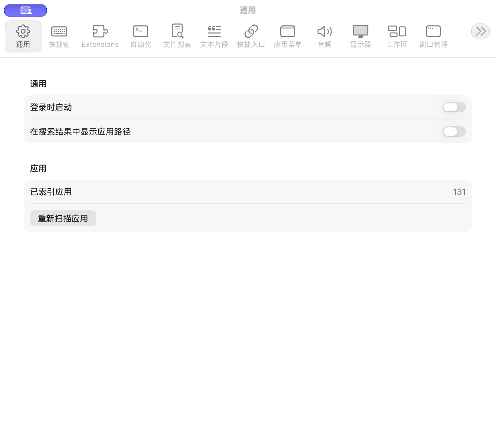

# 通用设置

批次：A · 改动前。

进入路径：菜单栏 → 设置 → 通用。

状态：两个开关关闭；显示应用索引数量。



## 源码定位

`zbox/Settings/SettingsView.swift:66`（采集时 HEAD）。使用 SwiftUI 原生控件、系统语义颜色及字体；用户可见文案位于 `zbox/Localizable.xcstrings`。设置外层布局由 `zbox/Settings/SettingsView.swift` 管理。

以下为定位用摘录，可能截断组件并省略回调、服务依赖，不能独立运行：

```swift
private struct GeneralSettingsView: View {
    let environment: AppEnvironment

    var body: some View {
        @Bindable var environment = environment

        Form {
            Section("General") {
                Toggle(
                    "Launch at Login",
                    isOn: Binding(
                        get: { environment.isLaunchAtLoginEnabled },
                        set: { environment.setLaunchAtLoginEnabled($0) }
                    )
                )
                if let error = environment.launchAtLoginError {
                    SettingsErrorView(message: error)
                }
                Toggle(
                    "Show Application Paths in Search Results",
                    isOn: Binding(
                        get: { environment.showsApplicationPathsInSearchResults },
                        set: { environment.setShowsApplicationPathsInSearchResults($0) }
                    )
                )
            }

            Section("Applications") {
                LabeledContent("Indexed Applications", value: "\(environment.applications.count)")
                Button("Reload Applications") {
                    environment.reloadApplications()
                }
                if let error = environment.applicationReloadError {
                    SettingsErrorView(message: error)
```

版本及覆盖限制见 [总索引](index.md)。截图只包含当前可见区域。表单草稿均取消；公开示例仅用于本地转换，采集后清除，未复制结果或保存设置。
