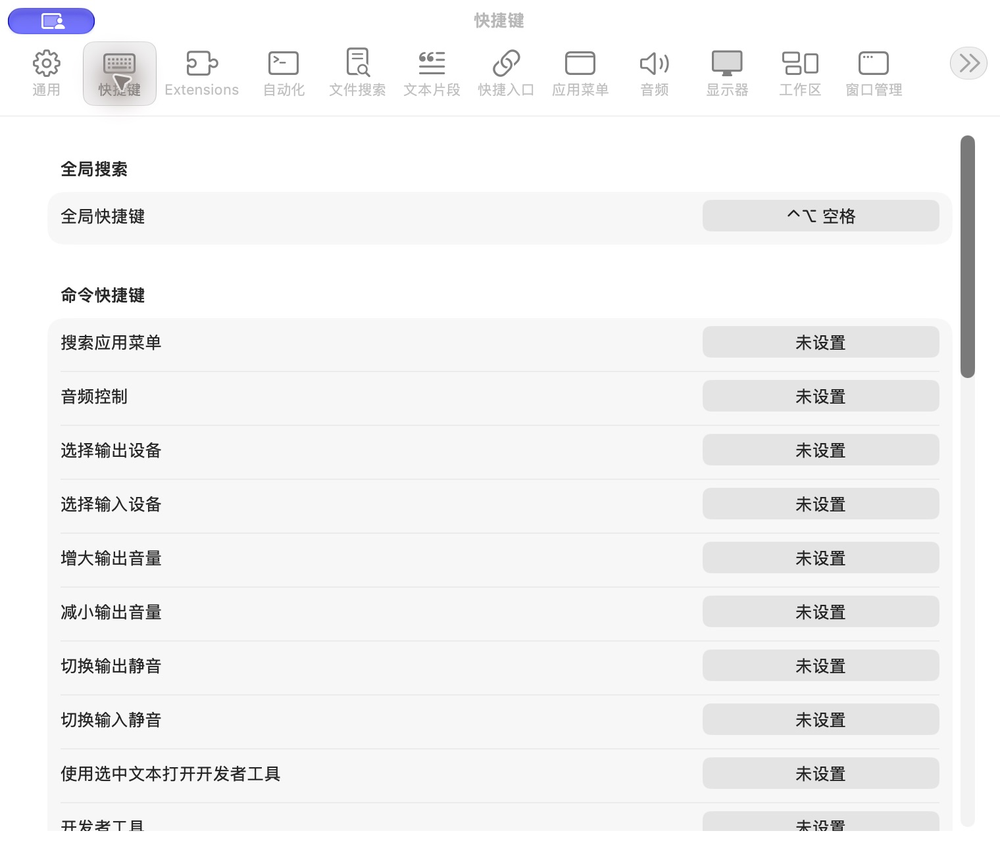

# 快捷键设置

批次：A · 改动前。

进入路径：设置 → 快捷键。

状态：命令快捷键未设置；只记录列表首屏。



## 源码定位

`zbox/Settings/SettingsView.swift:107`（采集时 HEAD）。使用 SwiftUI 原生控件、系统语义颜色及字体；用户可见文案位于 `zbox/Localizable.xcstrings`。设置外层布局由 `zbox/Settings/SettingsView.swift` 管理。

以下为定位用摘录，可能截断组件并省略回调、服务依赖，不能独立运行：

```swift
private struct ShortcutSettingsView: View {
    let environment: AppEnvironment

    var body: some View {
        @Bindable var environment = environment

        Form {
            Section("Root Search") {
                VStack(alignment: .leading, spacing: 6) {
                    LabeledContent("Global Hotkey") {
                        ShortcutRecorder(
                            hotkey: environment.rootSearchHotkey,
                            allowsClearing: false,
                            accessibilityLabel: String(localized: "Root Search shortcut"),
                            onChange: { hotkey in
                                guard let hotkey else { return }
                                environment.setRootSearchHotkey(hotkey)
                            },
                            onInvalid: environment.reportInvalidRootSearchHotkey,
                            onRecordingChanged: environment.setShortcutRecordingActive
                        )
                        .frame(width: 180)
                    }
                    if let error = environment.rootSearchHotkeyError {
                        Text(error)
                            .font(.caption)
                            .foregroundStyle(.red)
                    }
                }
            }

            Section("Command Shortcuts") {
                ForEach(environment.commandShortcutTargets) { target in
                    VStack(alignment: .leading, spacing: 6) {
```

版本及覆盖限制见 [总索引](index.md)。截图只包含当前可见区域。表单草稿均取消；公开示例仅用于本地转换，采集后清除，未复制结果或保存设置。
