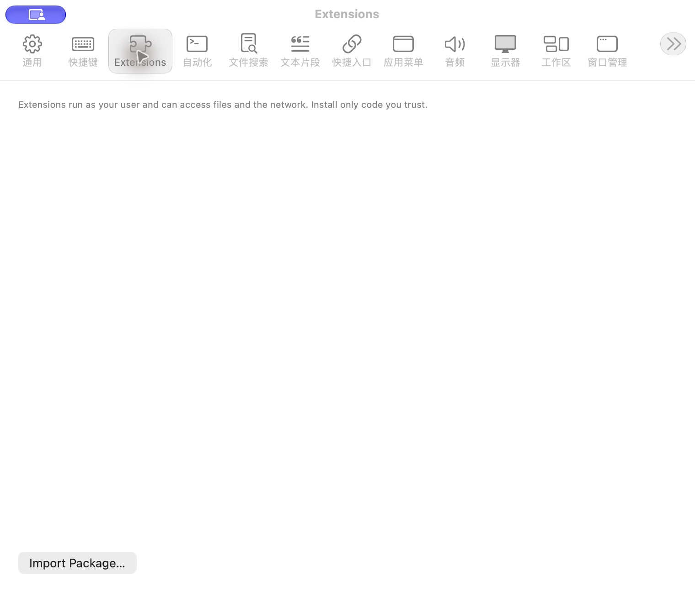

# 扩展设置

批次：A · 改动前。

进入路径：设置 → Extensions。

状态：未安装扩展；提示和按钮尚未中文本地化。



## 源码定位

`zbox/ExternalExtensions/ExtensionSettingsView.swift:3`（采集时 HEAD）。使用 SwiftUI 原生控件、系统语义颜色及字体；用户可见文案位于 `zbox/Localizable.xcstrings`。设置外层布局由 `zbox/Settings/SettingsView.swift` 管理。

以下为定位用摘录，可能截断组件并省略回调、服务依赖，不能独立运行：

```swift
struct ExtensionSettingsView: View {
    @Bindable var manager: ExtensionManager
    @State private var editing: ExtensionInstallation?
    @State private var removing: ExtensionInstallation?
    @State private var deleteData = false

    var body: some View {
        VStack(alignment: .leading, spacing: 12) {
            Text("Extensions run as your user and can access files and the network. Install only code you trust.")
                .font(.caption).foregroundStyle(.secondary)
            List(manager.items) { item in
                HStack {
                    Toggle(isOn: Binding(get: { item.enabled }, set: { enabled in Task { await manager.setEnabled(item, enabled) } })) {
                        VStack(alignment: .leading) {
                            Text(item.manifest.name)
                            Text("\(item.id) · \(item.manifest.version)").font(.caption).foregroundStyle(.secondary)
                        }
                    }
                    Spacer()
                    Button("Settings…") { editing = item }
                    Button("Uninstall") { deleteData = false; removing = item }
                }
            }
            HStack {
                Button("Import Package…", action: choosePackage)
                if manager.busy { ProgressView().controlSize(.small) }
            }
            if let error = manager.error { SettingsErrorView(message: error) }
        }
        .padding(20).disabled(manager.busy || manager.loadFailed)
        .sheet(item: Binding(get: { manager.candidate }, set: { _ in })) { item in
            VStack(alignment: .leading, spacing: 12) {
                Text(item.manifest.name).font(.title2)
                Text("\(item.id) · \(item.manifest.version)")
```

版本及覆盖限制见 [总索引](index.md)。截图只包含当前可见区域。表单草稿均取消；公开示例仅用于本地转换，采集后清除，未复制结果或保存设置。
