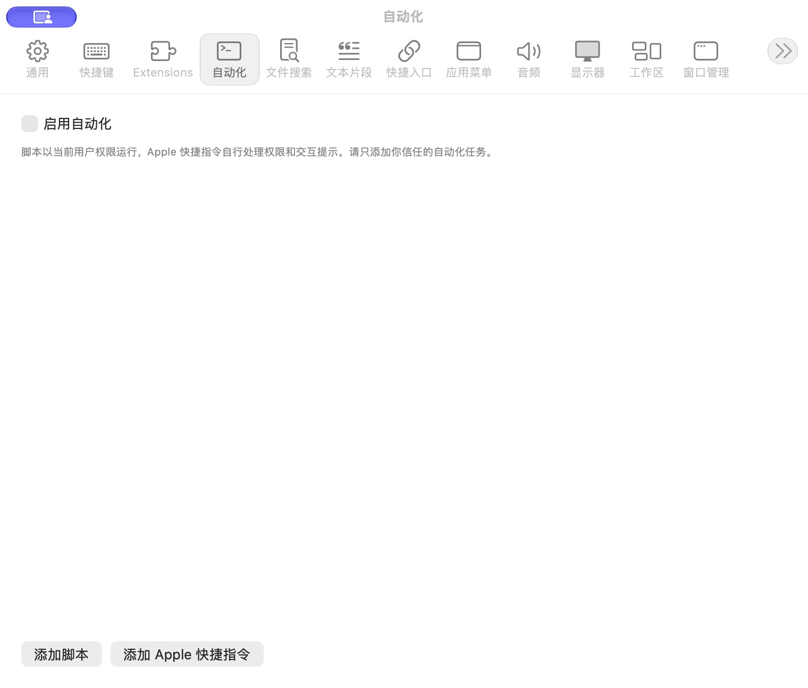

# 自动化设置

批次：A · 改动前。

进入路径：设置 → 自动化。

状态：功能关闭，列表为空。



## 源码定位

`zbox/Plugins/ScriptCommands/ScriptCommandsSettingsView.swift:3`（采集时 HEAD）。使用 SwiftUI 原生控件、系统语义颜色及字体；用户可见文案位于 `zbox/Localizable.xcstrings`。设置外层布局由 `zbox/Settings/SettingsView.swift` 管理。

以下为定位用摘录，可能截断组件并省略回调、服务依赖，不能独立运行：

```swift
struct ScriptCommandsSettingsView: View {
    let environment: AppEnvironment
    @State private var editing: ScriptCommand?
    private var plugin: ScriptCommandsPlugin { environment.scriptCommandsPlugin }

    var body: some View {
        VStack(alignment: .leading, spacing: 12) {
            Toggle("Enable Automation", isOn: Binding(get: { plugin.isEnabled }, set: environment.setScriptCommandsEnabled))
            Text("Scripts run as your user. Apple Shortcuts handles its own permissions and prompts. Add only automation you trust.")
                .font(.caption).foregroundStyle(.secondary)
            List(plugin.store.items) { item in
                HStack {
                    VStack(alignment: .leading) {
                        Text(item.name)
                        Text(item.shortcut?.name ?? item.path).font(.caption).foregroundStyle(.secondary).lineLimit(1)
                    }
                    Spacer()
                    if !item.enabled { Text("Disabled").foregroundStyle(.secondary) }
                    Button("Edit") { editing = item }
                    Button("Delete", role: .destructive) { environment.deleteScriptCommand(item) }
                }
            }
            HStack {
                Button("Add Script") { editing = ScriptCommand() }
                Button("Add Apple Shortcut") {
                    var item = ScriptCommand()
                    item.shortcut = AppleShortcutConfiguration(identifier: UUID(), name: "")
                    editing = item
                }
            }
            if let error = plugin.store.loadError ?? plugin.statusMessage { SettingsErrorView(message: error) }
        }.padding(20)
            .sheet(item: $editing) { ScriptCommandEditor(item: $0, save: environment.saveScriptCommand) }
    }
```

版本及覆盖限制见 [总索引](index.md)。截图只包含当前可见区域。表单草稿均取消；公开示例仅用于本地转换，采集后清除，未复制结果或保存设置。
