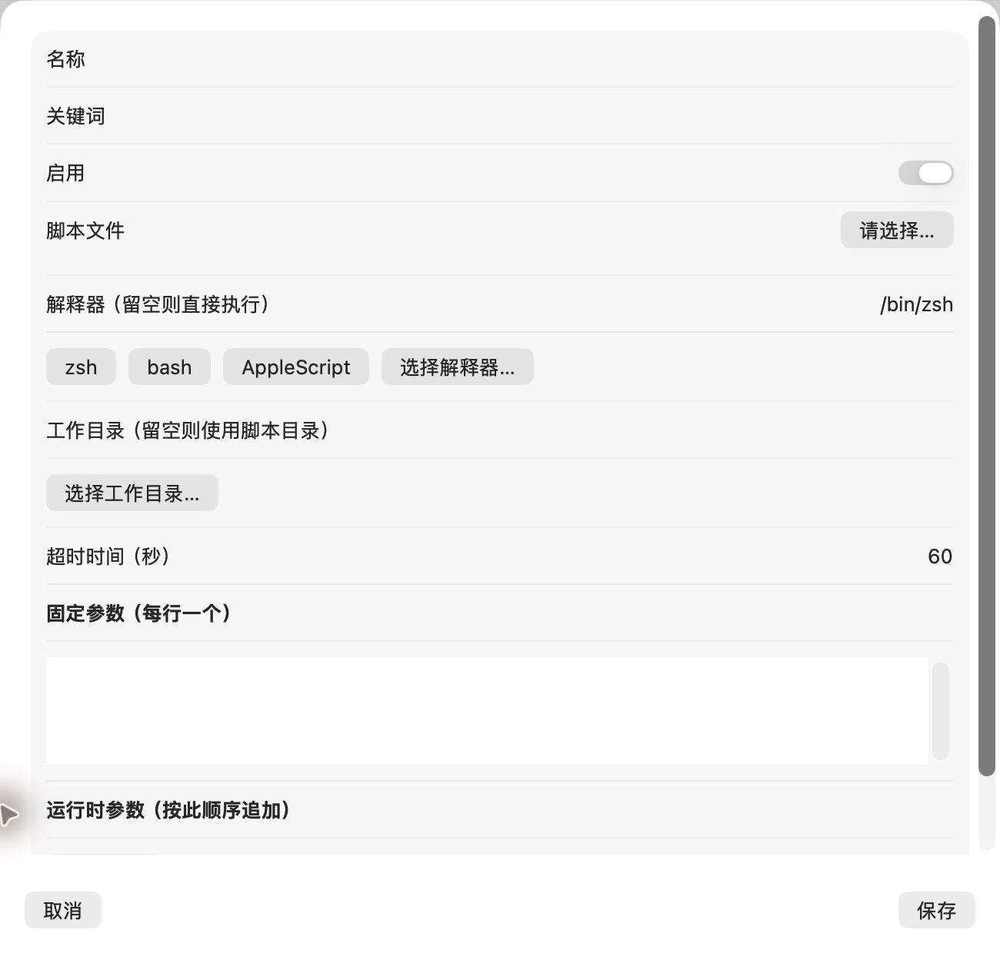

# 新增脚本表单

批次：A · 改动前。

进入路径：设置 → 自动化 → 添加脚本。

状态：空白草稿，随后取消，未保存或执行。



## 源码定位

`zbox/Plugins/ScriptCommands/ScriptCommandsSettingsView.swift:39`（采集时 HEAD）。使用 SwiftUI 原生控件、系统语义颜色及字体；用户可见文案位于 `zbox/Localizable.xcstrings`。设置外层布局由 `zbox/Settings/SettingsView.swift` 管理。

以下为定位用摘录，可能截断组件并省略回调、服务依赖，不能独立运行：

```swift
private struct ScriptCommandEditor: View {
    @Environment(\.dismiss) private var dismiss
    @State var item: ScriptCommand
    let save: (ScriptCommand) -> Bool
    @State private var error: String?
    @State private var shortcuts: [AppleShortcutEntry] = []
    @State private var isLoading = false
    @State private var refreshID = UUID()

    var body: some View {
        VStack {
            Form {
                TextField("Name", text: $item.name)
                TextField("Keywords", text: $item.keywords)
                Toggle("Enabled", isOn: $item.enabled)
                if item.shortcut != nil {
                    Picker("Apple Shortcut", selection: Binding(get: { item.shortcut?.identifier }, set: { id in
                        if let entry = shortcuts.first(where: { $0.id == id }) {
                            item.shortcut?.identifier = entry.id
                            item.shortcut?.name = entry.name
                            if item.name.isEmpty { item.name = entry.name }
                        }
                    })) {
                        if let current = item.shortcut, !shortcuts.contains(where: { $0.id == current.identifier }) {
                            Text(current.name.isEmpty ? String(localized: "Choose a Shortcut") : current.name).tag(Optional(current.identifier))
                        }
                        ForEach(shortcuts) { entry in
                            Text(shortcuts.filter { $0.name == entry.name }.count > 1
                                 ? "\(entry.name) · \(entry.id.uuidString.prefix(8))" : entry.name).tag(Optional(entry.id))
                        }
                    }
                    Button("Refresh Shortcuts") { refreshID = UUID() }.disabled(isLoading)
                    if isLoading { ProgressView().controlSize(.small) }
                    Toggle("Ask for Text Input", isOn: Binding(get: { item.shortcut?.acceptsText ?? false }, set: { item.shortcut?.acceptsText = $0 }))
```

版本及覆盖限制见 [总索引](index.md)。截图只包含当前可见区域。表单草稿均取消；公开示例仅用于本地转换，采集后清除，未复制结果或保存设置。
