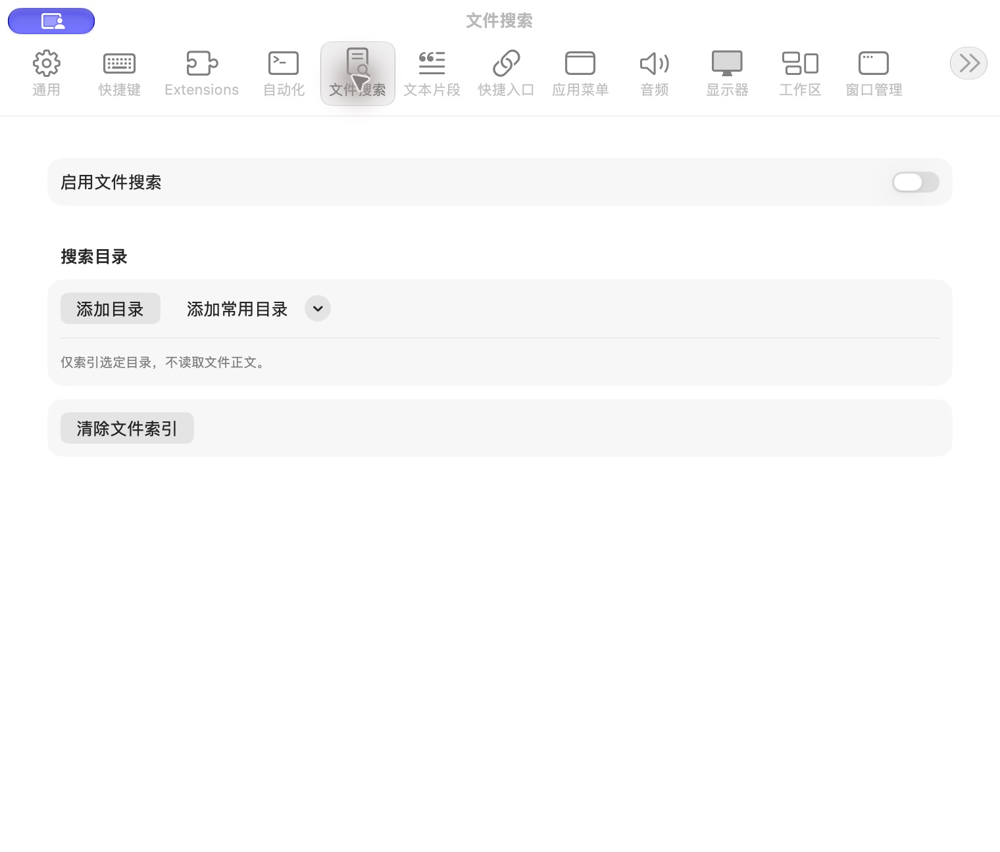

# 文件搜索设置

批次：A · 改动前。

进入路径：设置 → 文件搜索。

状态：功能关闭，未添加索引目录。



## 源码定位

`zbox/Plugins/FileSearch/FileSearchSettingsView.swift:3`（采集时 HEAD）。使用 SwiftUI 原生控件、系统语义颜色及字体；用户可见文案位于 `zbox/Localizable.xcstrings`。设置外层布局由 `zbox/Settings/SettingsView.swift` 管理。

以下为定位用摘录，可能截断组件并省略回调、服务依赖，不能独立运行：

```swift
struct FileSearchSettingsView: View {
    let environment: AppEnvironment
    @State private var clearing = false
    private var plugin: FileSearchPlugin { environment.fileSearchPlugin }

    var body: some View {
        Form {
            Toggle("Enable File Search", isOn: Binding(get: { plugin.isEnabled }, set: environment.setFileSearchEnabled))
            Section("Search Folders") {
                ForEach(plugin.settings.roots) { root in
                    VStack(alignment: .leading, spacing: 8) {
                        Text(root.url.path).textSelection(.enabled)
                        if let status = plugin.rootStatus[root.id] { Text(status).font(.caption).foregroundStyle(.secondary) }
                        Toggle("Include Hidden Files", isOn: Binding(get: { root.includesHidden }, set: {
                            var updated = root; updated.includesHidden = $0; plugin.save(updated)
                        }))
                        ForEach(root.exclusions, id: \.self) { path in
                            HStack {
                                Text(path).font(.caption)
                                Spacer()
                                Button("Remove Exclusion") {
                                    var updated = root; updated.exclusions.removeAll { $0 == path }; plugin.save(updated)
                                }
                            }
                        }
                        HStack {
                            Button("Rescan") { plugin.rescan(root) }.disabled(!plugin.isEnabled)
                            Button("Exclude Subfolder") { plugin.excludeFolder(from: root) }
                            Spacer()
                            Button("Remove Folder", role: .destructive) { plugin.remove(root) }
                        }
                    }
                }
                HStack {
```

版本及覆盖限制见 [总索引](index.md)。截图只包含当前可见区域。表单草稿均取消；公开示例仅用于本地转换，采集后清除，未复制结果或保存设置。
