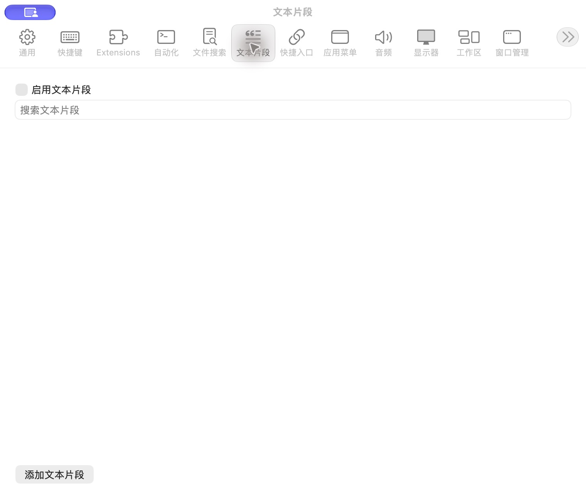

# 文本片段设置

批次：A · 改动前。

进入路径：设置 → 文本片段。

状态：功能关闭，列表为空。



## 源码定位

`zbox/Plugins/Snippets/SnippetsSettingsView.swift:3`（采集时 HEAD）。使用 SwiftUI 原生控件、系统语义颜色及字体；用户可见文案位于 `zbox/Localizable.xcstrings`。设置外层布局由 `zbox/Settings/SettingsView.swift` 管理。

以下为定位用摘录，可能截断组件并省略回调、服务依赖，不能独立运行：

```swift
struct SnippetsSettingsView: View {
    let environment: AppEnvironment
    @State private var query = ""
    @State private var deleting: Snippet?
    private var plugin: SnippetsPlugin { environment.snippetsPlugin }

    var body: some View {
        @Bindable var plugin = plugin
        VStack(alignment: .leading) {
            Toggle("Enable Snippets", isOn: Binding(get: { plugin.isEnabled }, set: environment.setSnippetsEnabled))
            TextField("Search Snippets", text: $query)
            List {
                ForEach(plugin.store.items.filter { query.isEmpty || [$0.name, $0.keywords, $0.body].contains { $0.localizedStandardContains(query) } }) { item in
                    HStack {
                        VStack(alignment: .leading) {
                            Text(item.name)
                            if !item.group.isEmpty { Text(item.group).font(.caption).foregroundStyle(.secondary) }
                        }
                        Spacer()
                        Button("Edit") { plugin.editingSnippet = item }
                        Button("Delete", role: .destructive) { deleting = item }
                    }
                }
            }
            Button("Add Snippet") { plugin.editingSnippet = Snippet() }
            if let error = plugin.store.loadError ?? plugin.statusMessage { SettingsErrorView(message: error) }
        }
        .padding(20)
        .sheet(item: $plugin.editingSnippet) { item in SnippetEditor(item: item) { environment.saveSnippet($0) } }
        .alert("Delete Snippet?", isPresented: Binding(get: { deleting != nil }, set: { if !$0 { deleting = nil } })) {
            Button("Cancel", role: .cancel) { deleting = nil }
            Button("Delete", role: .destructive) {
                if let deleting { environment.deleteSnippet(deleting) }
                deleting = nil
```

版本及覆盖限制见 [总索引](index.md)。截图只包含当前可见区域。表单草稿均取消；公开示例仅用于本地转换，采集后清除，未复制结果或保存设置。
