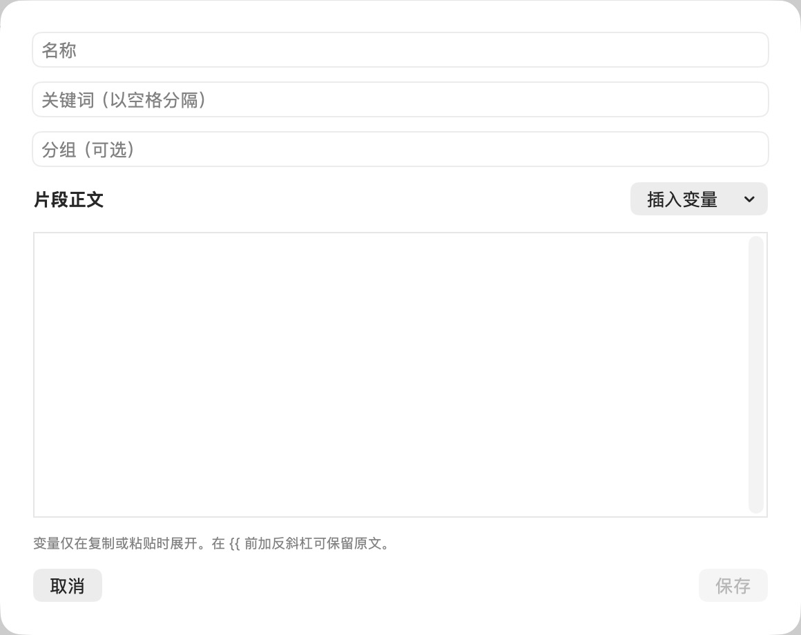

# 新增文本片段

批次：A · 改动前。

进入路径：设置 → 文本片段 → 添加片段。

状态：空白草稿，随后取消，未保存。



## 源码定位

`zbox/Plugins/Snippets/SnippetsSettingsView.swift:42`（采集时 HEAD）。使用 SwiftUI 原生控件、系统语义颜色及字体；用户可见文案位于 `zbox/Localizable.xcstrings`。设置外层布局由 `zbox/Settings/SettingsView.swift` 管理。

以下为定位用摘录，可能截断组件并省略回调、服务依赖，不能独立运行：

```swift
private struct SnippetEditor: View {
    @Environment(\.dismiss) private var dismiss
    @State var item: Snippet
    let save: (Snippet) -> Bool
    @State private var error: String?
    @State private var selection: TextSelection?
    @FocusState private var bodyFocused: Bool

    private func insert(_ token: String) {
        let range: Range<String.Index>
        if let selection, case .selection(let selectedRange) = selection.indices { range = selectedRange }
        else { range = item.body.endIndex..<item.body.endIndex }
        let offset = item.body.distance(from: item.body.startIndex, to: range.lowerBound)
        item.body.replaceSubrange(range, with: token)
        let cursor = item.body.index(item.body.startIndex, offsetBy: offset + token.count)
        selection = TextSelection(insertionPoint: cursor)
        bodyFocused = true
    }

    var body: some View {
        VStack(alignment: .leading, spacing: 12) {
            TextField("Name", text: $item.name)
            TextField("Keywords (separated by spaces)", text: $item.keywords)
            TextField("Group (optional)", text: $item.group)
            HStack {
                Text("Snippet Text").font(.headline)
                Spacer()
                Menu("Insert Variable") {
                    Button("Date (yyyy-MM-dd)") { insert("{{date}}") }
                    Button("Time (HH:mm)") { insert("{{time}}") }
                    Button("Clipboard Text") { insert("{{clipboard}}") }
                }
            }
            TextEditor(text: $item.body, selection: $selection)
```

版本及覆盖限制见 [总索引](index.md)。截图只包含当前可见区域。表单草稿均取消；公开示例仅用于本地转换，采集后清除，未复制结果或保存设置。
