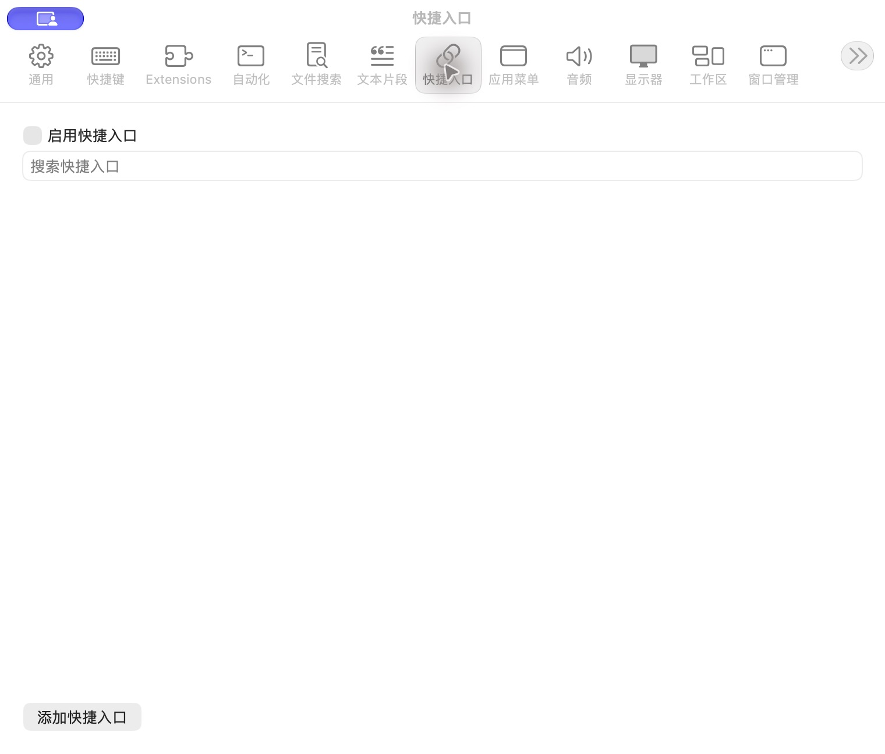

# 快捷入口设置

批次：A · 改动前。

进入路径：设置 → 快捷入口。

状态：功能关闭，列表为空。



## 源码定位

`zbox/Plugins/Quicklinks/QuicklinksSettingsView.swift:3`（采集时 HEAD）。使用 SwiftUI 原生控件、系统语义颜色及字体；用户可见文案位于 `zbox/Localizable.xcstrings`。设置外层布局由 `zbox/Settings/SettingsView.swift` 管理。

以下为定位用摘录，可能截断组件并省略回调、服务依赖，不能独立运行：

```swift
struct QuicklinksSettingsView: View {
    let environment: AppEnvironment
    @State private var query = ""
    @State private var editing: Quicklink?
    private var plugin: QuicklinksPlugin { environment.quicklinksPlugin }

    var body: some View {
        VStack(alignment: .leading) {
            Toggle("Enable Quicklinks", isOn: Binding(get: { plugin.isEnabled }, set: environment.setQuicklinksEnabled))
            TextField("Search Quicklinks", text: $query)
            List {
                ForEach(plugin.store.items.filter { query.isEmpty || $0.name.localizedStandardContains(query) || $0.keywords.localizedStandardContains(query) }) { item in
                    HStack {
                        VStack(alignment: .leading) {
                            Text(item.name)
                            Text(item.target).font(.caption).foregroundStyle(.secondary).lineLimit(1)
                        }
                        Spacer()
                        Button("Edit") { editing = item }
                        Button("Delete", role: .destructive) { environment.deleteQuicklink(item) }
                    }
                }
            }
            Button("Add Quicklink") { editing = Quicklink() }
            if let error = plugin.store.loadError ?? plugin.statusMessage { SettingsErrorView(message: error) }
        }
        .padding(20)
        .sheet(item: $editing) { item in
            QuicklinkEditor(item: item) { environment.saveQuicklink($0) }
        }
    }
}

private struct QuicklinkEditor: View {
```

版本及覆盖限制见 [总索引](index.md)。截图只包含当前可见区域。表单草稿均取消；公开示例仅用于本地转换，采集后清除，未复制结果或保存设置。
