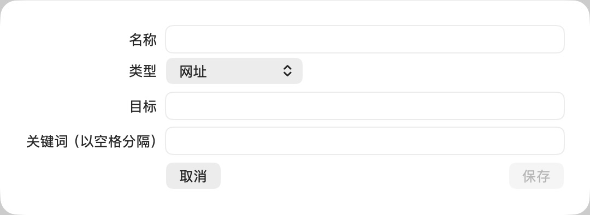

# 新增快捷入口

批次：A · 改动前。

进入路径：设置 → 快捷入口 → 添加快捷入口。

状态：空白 URL 草稿，随后取消，未保存。



## 源码定位

`zbox/Plugins/Quicklinks/QuicklinksSettingsView.swift:36`（采集时 HEAD）。使用 SwiftUI 原生控件、系统语义颜色及字体；用户可见文案位于 `zbox/Localizable.xcstrings`。设置外层布局由 `zbox/Settings/SettingsView.swift` 管理。

以下为定位用摘录，可能截断组件并省略回调、服务依赖，不能独立运行：

```swift
private struct QuicklinkEditor: View {
    @Environment(\.dismiss) private var dismiss
    @State var item: Quicklink
    let save: (Quicklink) -> Bool
    @State private var error: String?

    var body: some View {
        Form {
            TextField("Name", text: $item.name)
            Picker("Type", selection: $item.kind) {
                Text("Parameterized URL").tag(Quicklink.Kind.template)
                Text("URL").tag(Quicklink.Kind.url)
                Text("File or Folder").tag(Quicklink.Kind.file)
            }
            TextField("Target", text: $item.target)
            if item.kind == .template {
                TextField("Parameter Prompt", text: Binding(get: { item.parameterPrompt ?? "" }, set: { item.parameterPrompt = $0 }))
                Text("Insert {query} where the search value belongs.").font(.caption)
                if let url = try? item.destination() {
                    Text(url.absoluteString).font(.caption).foregroundStyle(.secondary).textSelection(.enabled)
                }
            }
            if item.kind == .file {
                Button("Choose File or Folder") {
                    let panel = NSOpenPanel()
                    panel.canChooseDirectories = true
                    panel.canChooseFiles = true
                    panel.allowsMultipleSelection = false
                    if panel.runModal() == .OK, let url = panel.url { item.target = url.path }
                }
            }
            TextField("Keywords (separated by spaces)", text: $item.keywords)
            if let error { SettingsErrorView(message: error) }
            HStack {
```

版本及覆盖限制见 [总索引](index.md)。截图只包含当前可见区域。表单草稿均取消；公开示例仅用于本地转换，采集后清除，未复制结果或保存设置。
