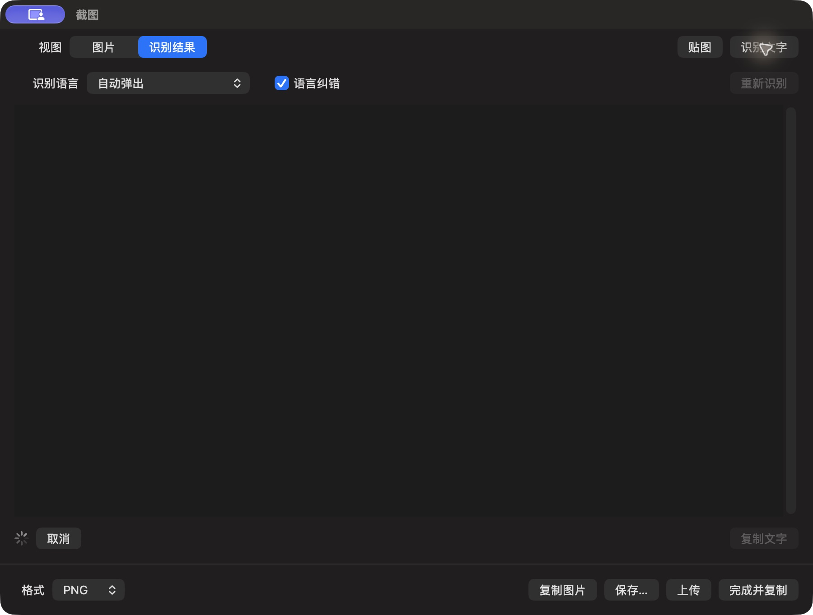

# OCR 识别进行中

批次 H · 2026-10-31 至 2026-11-01；dev `2f41c6a` 临时采集构建，版本 1.0（1）。

进入路径：截图编辑器 → 识别文字。

状态和操作：显示进度、取消及禁用结果操作。最终结果见101，并非失败状态。



## 可见范围与构建差异

深色外观，仅当前实际可见窗口。截图转为真实 PNG，保留原始尺寸，未重绘。为工具导航临时增加普通菜单入口、启动时展示主搜索，放宽主搜索失焦关闭，并给截图选择浮层添加窗口标题元数据；业务命令仍经原有入口执行。这些临时源码在结束时全部恢复，不能用本批证明正式版本焦点行为正确。测试数据和恢复记录见总索引。

## 源码

`zbox/Plugins/Screenshot/OCR/ScreenshotOCRView.swift:7`；文案资源 `zbox/Localizable.xcstrings`。以下局部摘录省略其余依赖，不能独立运行。

```swift
    var body: some View {
        @Bindable var session = document.ocr
        VStack(alignment: .leading, spacing: 12) {
            HStack {
                Picker("Recognition Language", selection: $session.language) {
                    Text("Automatic").tag("")
                    ForEach(ScreenshotTextRecognizer.languages, id: \.self) { language in
                        Text(Locale.current.localizedString(forIdentifier: language) ?? language).tag(language)
                    }
                }.frame(maxWidth: 280)
                Toggle("Language Correction", isOn: $session.correction)
                Spacer()
                Button("Recognize Again") { session.run(image: document.image, edit: document.edit) }
                    .disabled(session.isRunning)
            }
            TextEditor(text: $session.text).font(.system(.body, design: .monospaced))
                .autocorrectionDisabled().disabled(!session.hasResult)
                .accessibilityLabel("Recognized Text")
            HStack {
                if session.isRunning {
                    ProgressView().controlSize(.small)
                    Button("Cancel") { session.invalidate() }
                } else if let error = session.error {
                    Text(error).foregroundStyle(.red)
```
