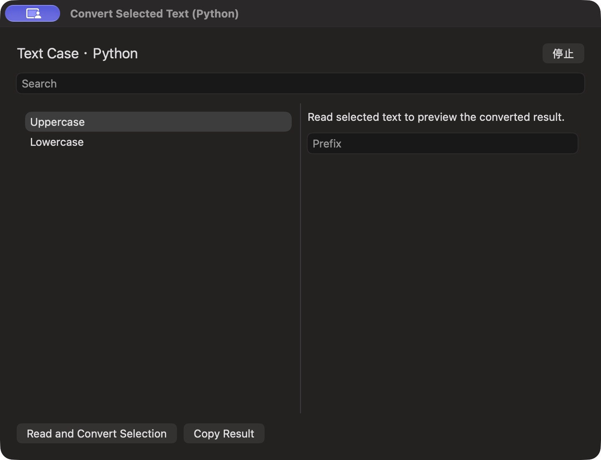

# 交互式扩展列表与详情

批次 H · 2026-10-31 至 2026-11-01；dev `2f41c6a` 临时采集构建，版本 1.0（1）。

进入路径：主搜索 → Convert Selected Text (Python)。

状态和操作：经用户单独确认安装 UI Catalog Text Case 1.0.0；显示初始列表、详情、Prefix 表单和动作按钮。未执行读取选区或复制动作，采集后关闭会话并停用扩展。



## 可见范围与构建差异

深色外观，仅当前实际可见窗口。截图转为真实 PNG，保留原始尺寸，未重绘。为工具导航临时增加普通菜单入口、启动时展示主搜索，放宽主搜索失焦关闭，并给截图选择浮层添加窗口标题元数据；业务命令仍经原有入口执行。这些临时源码在结束时全部恢复，不能用本批证明正式版本焦点行为正确。测试数据和恢复记录见总索引。

## 源码

`zbox/ExternalExtensions/ExtensionSessionView.swift:8`；文案资源 `zbox/Localizable.xcstrings`。以下局部摘录省略其余依赖，不能独立运行。

```swift
    var body: some View {
        let revision = session.viewRevision
        VStack(alignment: .leading, spacing: 12) {
            if !session.ready {
                ForEach(Array((session.command.parameters ?? []).enumerated()), id: \.element.id) { index, field in
                    TextField(field.name, text: $session.values[index]).disabled(session.running)
                }
            }
            HStack {
                Text(session.snapshot.title ?? session.command.name).font(.title2)
                Spacer()
                if session.snapshot.loading == true || (session.running && !session.ready) { ProgressView().controlSize(.small) }
                if !session.running { Button("Run", action: session.start) }
                Button("Stop", action: session.cancel).disabled(!session.running)
            }
            if session.snapshot.searchable == true {
                TextField("Search", text: Binding(get: { session.query }, set: session.sendQuery))
                    .textFieldStyle(.roundedBorder).disabled(!session.ready)
            }
            HSplitView {
                if let items = session.snapshot.items {
                    List(items, selection: $session.selectedID) { item in
                        VStack(alignment: .leading) {
                            Text(item.title)
```
