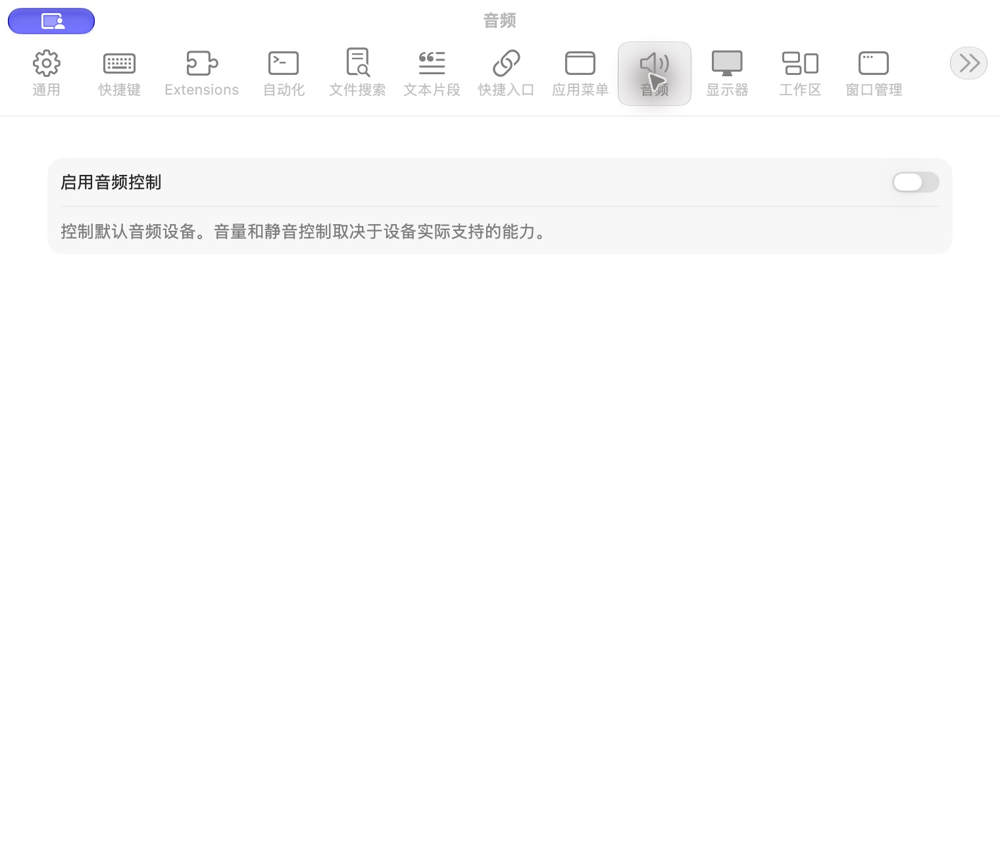

# 音频设置

批次：A · 改动前。

进入路径：设置 → 音频。

状态：功能关闭，未修改设备或音量。



## 源码定位

`zbox/Plugins/Audio/AudioPlugin.swift:170`（采集时 HEAD）。使用 SwiftUI 原生控件、系统语义颜色及字体；用户可见文案位于 `zbox/Localizable.xcstrings`。设置外层布局由 `zbox/Settings/SettingsView.swift` 管理。

以下为定位用摘录，可能截断组件并省略回调、服务依赖，不能独立运行：

```swift
struct AudioSettingsView: View {
    let environment: AppEnvironment
    var body: some View {
        Form {
            Toggle("Enable Audio Controls", isOn: Binding(get: { environment.audioPlugin.isEnabled }, set: environment.setAudioEnabled))
            Text("Control default audio devices. Available volume and mute controls depend on the device.").foregroundStyle(.secondary)
            if let message = environment.audioPlugin.statusMessage { SettingsErrorView(message: message) }
            if let message = environment.shortcutRegistrationError { SettingsErrorView(message: message) }
        }.settingsPane()
    }
}
```

版本及覆盖限制见 [总索引](index.md)。截图只包含当前可见区域。表单草稿均取消；公开示例仅用于本地转换，采集后清除，未复制结果或保存设置。
