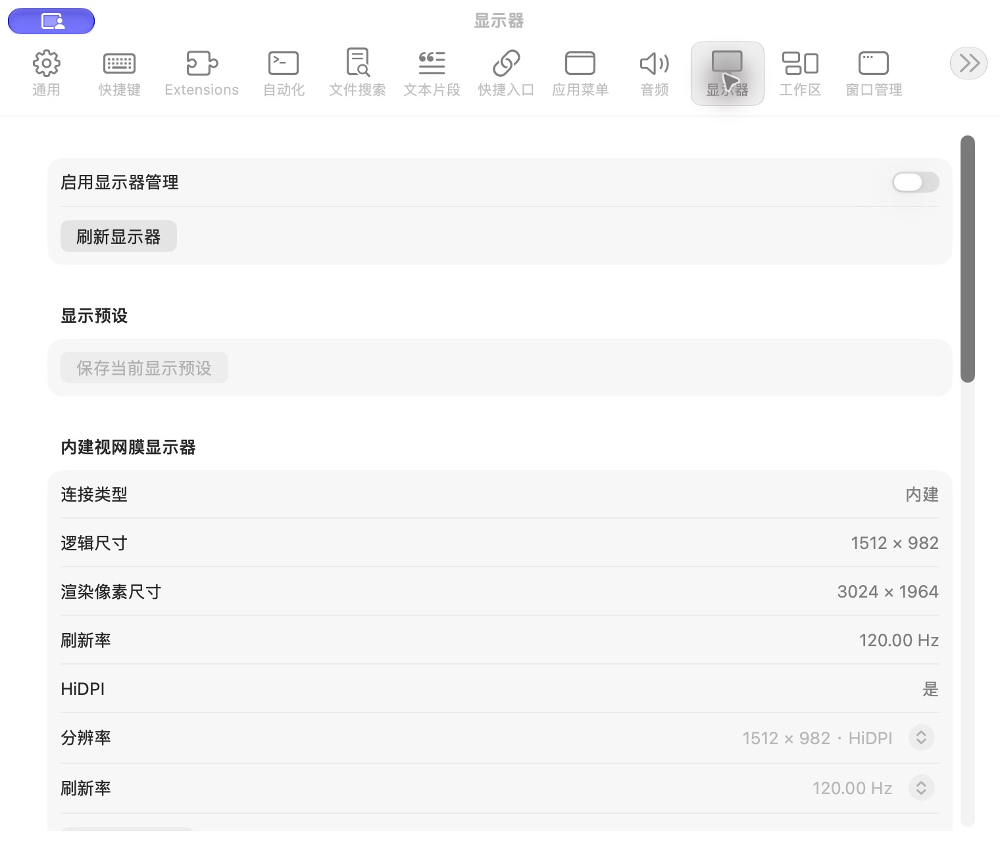

# 显示器设置

批次：A · 改动前。

进入路径：设置 → 显示器。

状态：功能关闭，显示器信息首屏；未修改显示模式。



## 源码定位

`zbox/Plugins/Display/DisplaySettingsView.swift:3`（采集时 HEAD）。使用 SwiftUI 原生控件、系统语义颜色及字体；用户可见文案位于 `zbox/Localizable.xcstrings`。设置外层布局由 `zbox/Settings/SettingsView.swift` 管理。

以下为定位用摘录，可能截断组件并省略回调、服务依赖，不能独立运行：

```swift
struct DisplaySettingsView: View {
    let environment: AppEnvironment
    @State private var editingPreset: DisplayPreset?
    @State private var configuringHiDPI: DisplayInfo?
    @State private var removingHiDPI: DisplayHiDPIInstallation?

    var body: some View {
        let plugin = environment.displayPlugin
        Form {
            Section {
                Toggle("Enable Display", isOn: Binding(get: { plugin.isEnabled }, set: environment.setDisplayEnabled))
                    .disabled(plugin.hiDPI.isBusy)
                Button("Refresh Displays", action: plugin.refresh)
                if let message = plugin.statusMessage { Text(message).font(.caption) }
            }
            Section("Display Presets") {
                Button("Save Current Display Preset") { editingPreset = plugin.snapshot() }
                    .disabled(!plugin.isEnabled || plugin.displays.isEmpty || plugin.change.pending != nil)
                if let error = plugin.presets.errorMessage { SettingsErrorView(message: error) }
                ForEach(plugin.presets.presets) { preset in
                    HStack {
                        Text(preset.name).lineLimit(1).help(preset.name)
                        Spacer()
                        Button("Apply") { environment.applyDisplayPreset(preset) }
                            .disabled(!plugin.isEnabled || plugin.change.pending != nil || plugin.hiDPI.isBusy)
                        Menu {
                            Button("Rename") { plugin.statusMessage = nil; editingPreset = preset }
                            Button("Delete", role: .destructive) { environment.deleteDisplayPreset(preset) }
                        } label: { Image(systemName: "ellipsis") }
                        .menuStyle(.borderlessButton).fixedSize()
                        .accessibilityLabel("Display Preset Actions")
                    }
                }
            }
```

版本及覆盖限制见 [总索引](index.md)。截图只包含当前可见区域。表单草稿均取消；公开示例仅用于本地转换，采集后清除，未复制结果或保存设置。
