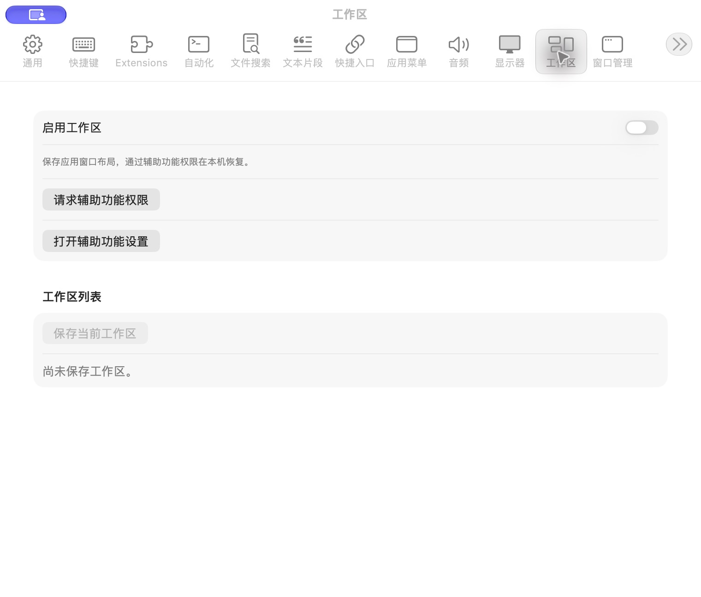

# 工作区设置

批次：A · 改动前。

进入路径：设置 → 工作区。

状态：功能关闭，无保存的工作区，辅助功能未授权。



## 源码定位

`zbox/Plugins/Workspace/WorkspaceSettingsView.swift:3`（采集时 HEAD）。使用 SwiftUI 原生控件、系统语义颜色及字体；用户可见文案位于 `zbox/Localizable.xcstrings`。设置外层布局由 `zbox/Settings/SettingsView.swift` 管理。

以下为定位用摘录，可能截断组件并省略回调、服务依赖，不能独立运行：

```swift
struct WorkspaceSettingsView: View {
    let environment: AppEnvironment
    @State private var editing: WorkspaceLayout?

    var body: some View {
        @Bindable var plugin = environment.workspacePlugin
        Form {
            Section {
                Toggle("Enable Workspace", isOn: Binding(get: { plugin.isEnabled },
                    set: environment.setWorkspaceEnabled))
                Text("Save application window layouts and restore them locally using Accessibility permission.")
                    .font(.caption).foregroundStyle(.secondary)
                if !environment.isAccessibilityTrusted {
                    Button("Request Accessibility Permission", action: environment.requestAccessibilityPermission)
                    Button("Open Accessibility Settings", action: environment.openAccessibilitySettings)
                }
                if let message = plugin.statusMessage ?? plugin.store.errorMessage {
                    Text(message).font(.caption).foregroundStyle(.secondary)
                }
            }
            if plugin.isRestoring || !plugin.results.isEmpty {
                Section("Latest Restoration") {
                    if plugin.isRestoring {
                        HStack {
                            ProgressView().controlSize(.small)
                            Text(plugin.restoringName ?? "")
                            Spacer()
                            Button("Cancel", action: plugin.cancelRestore)
                        }
                    }
                    ForEach(plugin.results) { result in
                        LabeledContent(result.applicationName) {
                            Text(result.message).foregroundStyle(result.succeeded ? Color.secondary : Color.red)
                        }
```

版本及覆盖限制见 [总索引](index.md)。截图只包含当前可见区域。表单草稿均取消；公开示例仅用于本地转换，采集后清除，未复制结果或保存设置。
