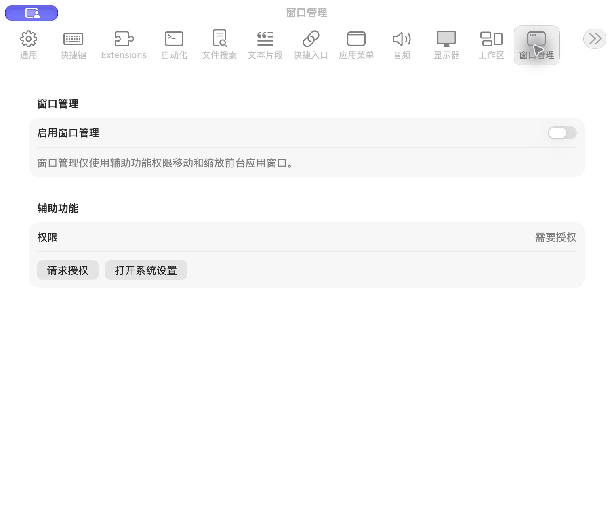

# 窗口管理设置

批次：A · 改动前。

进入路径：设置 → 窗口管理。

状态：功能关闭，辅助功能未授权。



## 源码定位

`zbox/Plugins/WindowManagement/WindowManagementSettingsView.swift:3`（采集时 HEAD）。使用 SwiftUI 原生控件、系统语义颜色及字体；用户可见文案位于 `zbox/Localizable.xcstrings`。设置外层布局由 `zbox/Settings/SettingsView.swift` 管理。

以下为定位用摘录，可能截断组件并省略回调、服务依赖，不能独立运行：

```swift
struct WindowManagementSettingsView: View {
    let environment: AppEnvironment

    var body: some View {
        @Bindable var environment = environment

        Form {
            Section("Window Management") {
                Toggle(
                    "Enable Window Management",
                    isOn: Binding(
                        get: { environment.windowManagementPlugin.isEnabled },
                        set: { environment.setWindowManagementEnabled($0) }
                    )
                )
                Text("Window Management uses Accessibility only to move and resize the frontmost application window.")
                    .foregroundStyle(.secondary)
            }

            Section("Accessibility") {
                LabeledContent(
                    "Permission",
                    value: environment.isAccessibilityTrusted
                        ? String(localized: "Granted")
                        : String(localized: "Required")
                )
                HStack {
                    Button("Request Permission") {
                        environment.requestAccessibilityPermission()
                    }
                    Button("Open System Settings") {
                        environment.openAccessibilitySettings()
                    }
                }
```

版本及覆盖限制见 [总索引](index.md)。截图只包含当前可见区域。表单草稿均取消；公开示例仅用于本地转换，采集后清除，未复制结果或保存设置。
