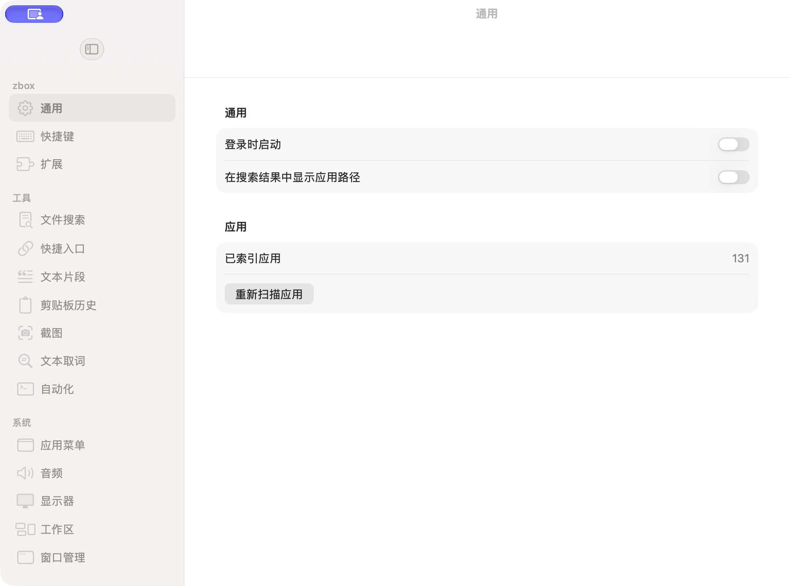

# 新版通用与分组侧栏

批次：B · 首次设置核对。

进入路径：设置 → 通用。

状态：15 个设置入口均在侧栏中显示。此截图为窗口场景尺寸策略补正前。



## 源码定位

`zbox/Settings/SettingsView.swift:3`（当前工作区）。使用 SwiftUI 原生控件、系统语义颜色及字体；用户可见文案位于 `zbox/Localizable.xcstrings`。设置外层布局由 `zbox/Settings/SettingsView.swift` 管理。

以下为定位用摘录，可能截断组件并省略回调、服务依赖，不能独立运行：

```swift
struct SettingsView: View {
    let environment: AppEnvironment

    var body: some View {
        @Bindable var environment = environment

        NavigationSplitView {
            List(selection: Binding<SettingsTab?>(
                get: { environment.selectedSettingsTab },
                set: { if let tab = $0 { environment.selectedSettingsTab = tab } }
            )) {
                settingsSection("zbox", tabs: [.general, .shortcuts, .extensions])
                settingsSection("Tools", tabs: [.fileSearch, .quicklinks, .snippets, .clipboardHistory,
                                                .screenshot, .textLookup, .scriptCommands])
                settingsSection("System", tabs: [.appMenu, .audio, .display, .workspace, .windowManagement])
            }
            .listStyle(.sidebar)
            .navigationSplitViewColumnWidth(min: 180, ideal: 210, max: 260)
        } detail: {
            settingsDetail
                .frame(minWidth: 600, maxWidth: .infinity, maxHeight: .infinity)
                .navigationTitle(environment.selectedSettingsTab.title)
        }
        .frame(minWidth: 860, idealWidth: 940, maxWidth: .infinity,
               minHeight: 580, idealHeight: 660, maxHeight: .infinity)
        .background(SettingsWindowConfiguration())
    }

    private func settingsSection(_ title: LocalizedStringKey, tabs: [SettingsTab]) -> some View {
        Section(title) {
            ForEach(tabs, id: \.self) { tab in
                Label(tab.title, systemImage: tab.systemImage)
                    .tag(tab)
            }
```

版本及覆盖限制见 [总索引](index.md)。截图只包含当前可见区域。表单草稿均取消；公开示例仅用于本地转换，采集后清除，未复制结果或保存设置。
