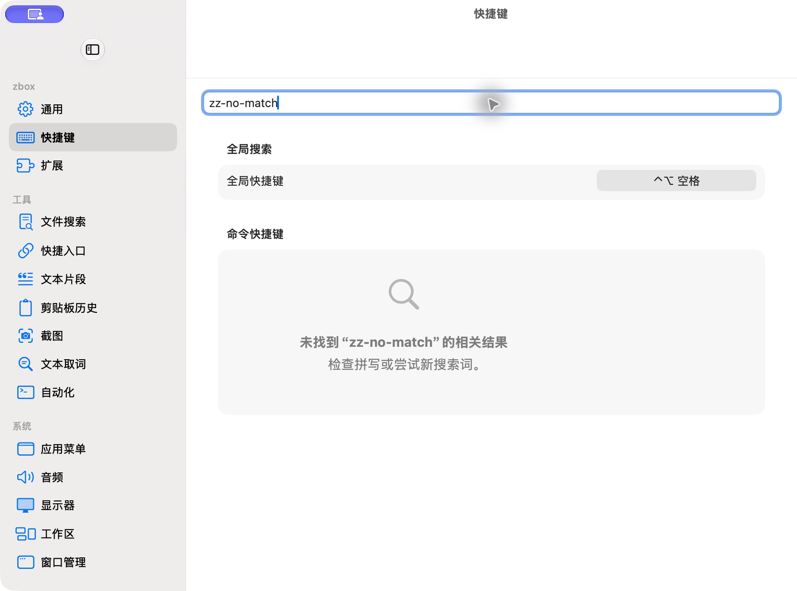

# 快捷键无匹配

批次：B · 首次设置核对。

进入路径：设置 → 快捷键 → 输入 zz-no-match。

状态：显示系统无匹配提示；采集后清空查询。



## 源码定位

`zbox/Settings/SettingsView.swift:110`（当前工作区）。使用 SwiftUI 原生控件、系统语义颜色及字体；用户可见文案位于 `zbox/Localizable.xcstrings`。设置外层布局由 `zbox/Settings/SettingsView.swift` 管理。

以下为定位用摘录，可能截断组件并省略回调、服务依赖，不能独立运行：

```swift
private struct ShortcutSettingsView: View {
    let environment: AppEnvironment
    @State private var query = ""

    var body: some View {
        @Bindable var environment = environment

        let targets = environment.commandShortcutTargets.filter {
            query.isEmpty || $0.title.localizedStandardContains(query)
        }

        VStack(spacing: 0) {
            TextField("Search Command Shortcuts", text: $query)
                .textFieldStyle(.roundedBorder)
                .padding(.horizontal, 20)
                .padding(.top, 16)
            Form {
                Section("Root Search") {
                    VStack(alignment: .leading, spacing: 6) {
                        LabeledContent("Global Hotkey") {
                            ShortcutRecorder(
                                hotkey: environment.rootSearchHotkey,
                                allowsClearing: false,
                                accessibilityLabel: String(localized: "Root Search shortcut"),
                                onChange: { hotkey in
                                    guard let hotkey else { return }
                                    environment.setRootSearchHotkey(hotkey)
                                },
                                onInvalid: environment.reportInvalidRootSearchHotkey,
                                onRecordingChanged: environment.setShortcutRecordingActive
                            )
                            .frame(width: 180)
                        }
                        if let error = environment.rootSearchHotkeyError {
```

版本及覆盖限制见 [总索引](index.md)。截图只包含当前可见区域。表单草稿均取消；公开示例仅用于本地转换，采集后清除，未复制结果或保存设置。
