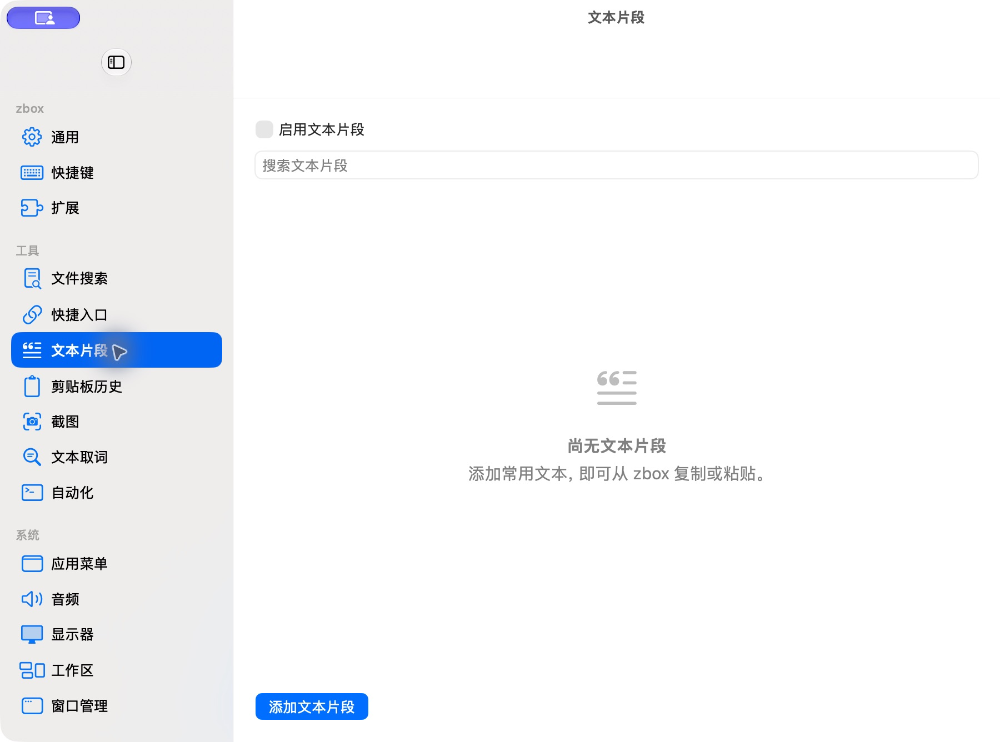

# 新版文本片段空状态

批次：B · 首次设置核对。

进入路径：设置 → 文本片段。

状态：未启用功能，空状态与添加入口正常显示。



## 源码定位

`zbox/Plugins/Snippets/SnippetsSettingsView.swift:3`（当前工作区）。使用 SwiftUI 原生控件、系统语义颜色及字体；用户可见文案位于 `zbox/Localizable.xcstrings`。设置外层布局由 `zbox/Settings/SettingsView.swift` 管理。

以下为定位用摘录，可能截断组件并省略回调、服务依赖，不能独立运行：

```swift
struct SnippetsSettingsView: View {
    let environment: AppEnvironment
    @State private var query = ""
    @State private var deleting: Snippet?
    private var plugin: SnippetsPlugin { environment.snippetsPlugin }

    var body: some View {
        @Bindable var plugin = plugin
        let items = plugin.store.items.filter { query.isEmpty || [$0.name, $0.keywords, $0.body].contains { $0.localizedStandardContains(query) } }
        VStack(alignment: .leading, spacing: 12) {
            Toggle("Enable Snippets", isOn: Binding(get: { plugin.isEnabled }, set: environment.setSnippetsEnabled))
            TextField("Search Snippets", text: $query)
            List {
                ForEach(items) { item in
                    HStack {
                        VStack(alignment: .leading) {
                            Text(item.name)
                            if !item.group.isEmpty { Text(item.group).font(.caption).foregroundStyle(.secondary) }
                        }
                        Spacer()
                        Button("Edit") { plugin.editingSnippet = item }
                        Button("Delete", role: .destructive) { deleting = item }
                    }
                }
            }
            .overlay {
                if plugin.store.loadError == nil && items.isEmpty {
                    if query.isEmpty {
                        ContentUnavailableView("No Snippets Yet", systemImage: "text.quote",
                                               description: Text("Add reusable text to copy or paste from zbox."))
                    } else {
                        ContentUnavailableView.search(text: query)
                    }
                }
```

版本及覆盖限制见 [总索引](index.md)。截图只包含当前可见区域。表单草稿均取消；公开示例仅用于本地转换，采集后清除，未复制结果或保存设置。
