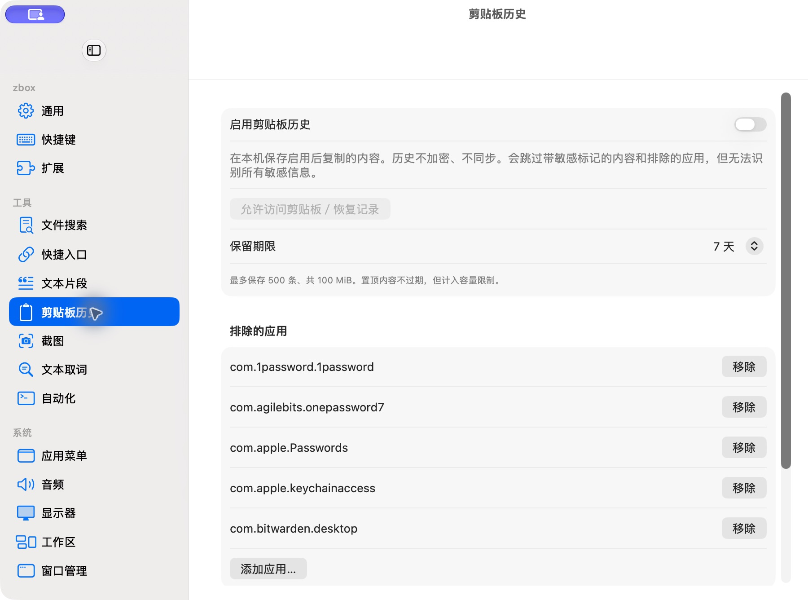

# 剪贴板历史设置

批次：B · 首次设置核对。

进入路径：设置 → 剪贴板历史。

状态：功能关闭；保留期限和默认排除应用可见，底部授权与清空操作在滚动范围内。未改变配置。



## 源码定位

`zbox/Plugins/ClipboardHistory/ClipboardHistoryView.swift:73`（当前工作区）。使用 SwiftUI 原生控件、系统语义颜色及字体；用户可见文案位于 `zbox/Localizable.xcstrings`。设置外层布局由 `zbox/Settings/SettingsView.swift` 管理。

以下为定位用摘录，可能截断组件并省略回调、服务依赖，不能独立运行：

```swift
struct ClipboardHistorySettingsView: View {
    @Bindable var plugin: ClipboardHistoryPlugin
    let onEnabledChanged: @MainActor @Sendable (Bool) -> Void
    let shortcutError: String?
    @State private var confirmsClear = false

    var body: some View {
        Form {
            Toggle("Enable Clipboard History", isOn: Binding(get: { plugin.isEnabled }, set: onEnabledChanged))
            Text("Stores future copies on this Mac. History is not encrypted or synced. Sensitive markers and excluded apps are skipped, but not all secrets can be detected.")
                .foregroundStyle(.secondary)
            if let message = plugin.statusMessage { Text(message).foregroundStyle(.secondary) }
            if let shortcutError { SettingsErrorView(message: shortcutError) }
            Button("Allow Clipboard Access / Resume", action: plugin.requestClipboardAccess)
                .disabled(!plugin.isEnabled || plugin.isRecording)
            Picker("Keep History", selection: $plugin.retentionDays) {
                Text("1 Day").tag(1)
                Text("7 Days").tag(7)
                Text("30 Days").tag(30)
            }
            Text("Up to 500 items and 100 MiB. Pinned items do not expire but count toward the limit.")
                .font(.caption).foregroundStyle(.secondary)
            Section("Excluded Applications") {
                ForEach(plugin.excludedApplications.sorted(), id: \.self) { id in
                    HStack {
                        Text(id).lineLimit(1).truncationMode(.middle)
                        Spacer()
                        Button("Remove") { plugin.removeExcludedApplication(id) }
                    }
                }
                Button("Add Application…", action: plugin.chooseExcludedApplication)
            }
            Button("Request Accessibility for Direct Paste", action: plugin.requestPastePermission)
            Button("Open Accessibility Settings", action: plugin.openAccessibilitySettings)
```

版本及覆盖限制见 [总索引](index.md)。截图只包含当前可见区域。表单草稿均取消；公开示例仅用于本地转换，采集后清除，未复制结果或保存设置。
