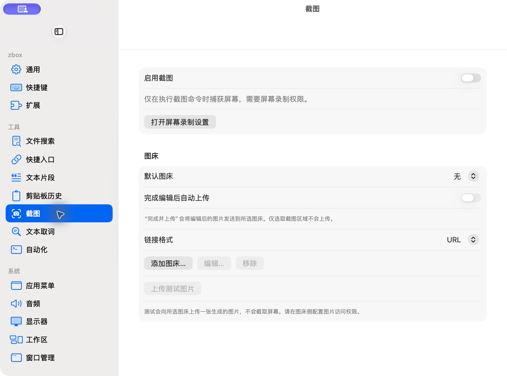

# 截图设置

批次：B · 首次设置核对。

进入路径：设置 → 截图。

状态：功能关闭，无图床；未授权录屏或上传。



## 源码定位

`zbox/Plugins/Screenshot/Settings/ScreenshotSettingsView.swift:3`（当前工作区）。使用 SwiftUI 原生控件、系统语义颜色及字体；用户可见文案位于 `zbox/Localizable.xcstrings`。设置外层布局由 `zbox/Settings/SettingsView.swift` 管理。

以下为定位用摘录，可能截断组件并省略回调、服务依赖，不能独立运行：

```swift
struct ScreenshotSettingsView: View {
    let plugin: ScreenshotPlugin
    let onEnabledChanged: @MainActor @Sendable (Bool) -> Void
    let shortcutError: String?
    var body: some View {
        Form {
            Toggle("Enable Screenshot", isOn: Binding(get: { plugin.isEnabled }, set: onEnabledChanged))
            Text("Captures only when you run a screenshot command. Screen Recording permission is required.")
                .foregroundStyle(.secondary)
            Button("Open Screen Recording Settings", action: plugin.openScreenRecordingSettings)
            ScreenshotHostingView(settings: plugin.hosting, plugin: plugin)
            if let status = plugin.statusMessage { Text(status).foregroundStyle(.secondary) }
            if let shortcutError { SettingsErrorView(message: shortcutError) }
        }.settingsPane()
    }
}
```

版本及覆盖限制见 [总索引](index.md)。截图只包含当前可见区域。表单草稿均取消；公开示例仅用于本地转换，采集后清除，未复制结果或保存设置。
