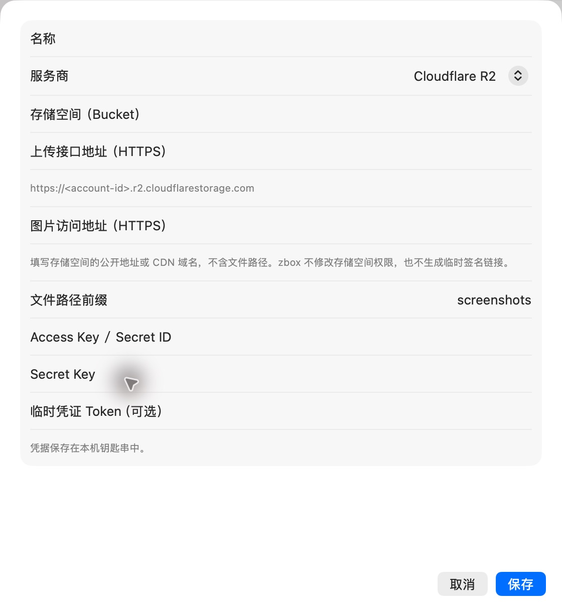

# 新增图床表单

批次：B · 首次设置核对。

进入路径：设置 → 截图 → 添加图床。

状态：空白 Cloudflare R2 表单；未输入凭据，随后取消，未保存。



## 源码定位

`zbox/Plugins/Screenshot/Settings/ScreenshotHostingView.swift:54`（当前工作区）。使用 SwiftUI 原生控件、系统语义颜色及字体；用户可见文案位于 `zbox/Localizable.xcstrings`。设置外层布局由 `zbox/Settings/SettingsView.swift` 管理。

以下为定位用摘录，可能截断组件并省略回调、服务依赖，不能独立运行：

```swift
private struct ScreenshotHostEditor: View {
    let settings: ScreenshotHostingSettings
    @State private var profile: ScreenshotHostingProfile
    @State private var credentials = ScreenshotHostCredentials()
    @State private var errorMessage: String?
    @State private var credentialsLoaded = false
    @Environment(\.dismiss) private var dismiss

    init(settings: ScreenshotHostingSettings, initial: ScreenshotHostingProfile) {
        self.settings = settings
        _profile = State(initialValue: initial)
    }

    var body: some View {
        VStack(spacing: 0) {
            Form {
                TextField("Name", text: $profile.name)
                Picker("Provider", selection: $profile.provider) {
                    ForEach(ScreenshotHost.allCases) { Text($0.title).tag($0) }
                }.disabled(settings.profiles.contains(where: { $0.id == profile.id }))
                if profile.provider == .smms {
                    Text("SM.MS uploads have moved to S.EE. Enter a S.EE API key; the old SM.MS upload endpoint is no longer used.")
                        .font(.caption).foregroundStyle(.secondary)
                    SecureField("S.EE API Key", text: $credentials.secretKey)
                } else {
                    TextField(profile.provider == .upyun ? String(localized: "Service Name") : String(localized: "Bucket"), text: $profile.bucket)
                    if profile.provider.needsRegion {
                        TextField("Region", text: $profile.region)
                        Text(regionHint).font(.caption).foregroundStyle(.secondary)
                    }
                    if profile.provider.needsEndpoint {
                        TextField("Upload Endpoint (HTTPS)", text: $profile.endpoint)
                        Text(profile.provider == .r2 ? "https://<account-id>.r2.cloudflarestorage.com" : "https://upload.qiniup.com")
                            .font(.caption).foregroundStyle(.secondary)
```

版本及覆盖限制见 [总索引](index.md)。截图只包含当前可见区域。表单草稿均取消；公开示例仅用于本地转换，采集后清除，未复制结果或保存设置。
