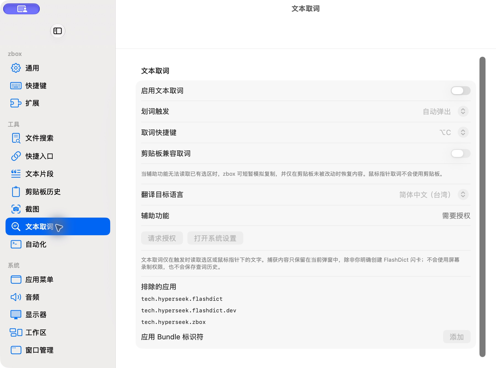

# 文本取词设置

批次：B · 首次设置核对。

进入路径：设置 → 文本取词。

状态：功能关闭，辅助功能未授权，未修改触发方式或语言。



## 源码定位

`zbox/Plugins/TextLookup/Settings/TextLookupSettingsView.swift:3`（当前工作区）。使用 SwiftUI 原生控件、系统语义颜色及字体；用户可见文案位于 `zbox/Localizable.xcstrings`。设置外层布局由 `zbox/Settings/SettingsView.swift` 管理。

以下为定位用摘录，可能截断组件并省略回调、服务依赖，不能独立运行：

```swift
struct TextLookupSettingsView: View {
    let environment: AppEnvironment
    @State private var excludedBundleIdentifier = ""

    private let commonTargetLanguages = ["zh-Hans", "en", "ja", "ko", "fr", "de", "es"]

    var body: some View {
        @Bindable var plugin = environment.textLookupPlugin
        @Bindable var settings = plugin.settings

        Section("Text Lookup") {
            Toggle(
                "Enable Text Lookup",
                isOn: Binding(
                    get: { settings.isEnabled },
                    set: { environment.setTextLookupEnabled($0) }
                )
            )
            if let message = environment.textLookupError ?? plugin.statusMessage {
                Text(message)
                    .font(.caption)
                    .foregroundStyle(.red)
            }

            Group {
                Picker(
                "Selection Trigger",
                selection: Binding(
                    get: { settings.selectionMode },
                    set: { settings.setSelectionMode($0) }
                )
                ) {
                    ForEach(TextLookupSelectionMode.allCases) { mode in
                        Text(mode.label).tag(mode)
```

版本及覆盖限制见 [总索引](index.md)。截图只包含当前可见区域。表单草稿均取消；公开示例仅用于本地转换，采集后清除，未复制结果或保存设置。
