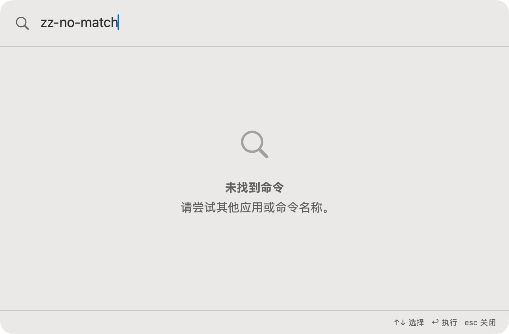

# 主搜索无匹配

批次：C · 主搜索与工具核对。

进入路径：主搜索 → 输入 zz-no-match。

状态：显示无匹配提示，随后替换为计算器查询。



## 源码定位

`zbox/Search/RootSearchView.swift:3`（当前工作区）。使用 SwiftUI 原生控件、系统语义颜色及字体；用户可见文案位于 `zbox/Localizable.xcstrings`。设置外层布局由 `zbox/Settings/SettingsView.swift` 管理。

以下为定位用摘录，可能截断组件并省略回调、服务依赖，不能独立运行：

```swift
struct RootSearchView: View {
    let environment: AppEnvironment

    @FocusState private var isSearchFocused: Bool

    var body: some View {
        @Bindable var environment = environment
        let results = environment.searchResults
        let selectedID = environment.selectedCommandID ?? results.first?.id

        VStack(spacing: 0) {
            HStack(spacing: 12) {
                Image(systemName: "magnifyingglass")
                    .foregroundStyle(.secondary)
                    .accessibilityHidden(true)
                TextField("Search apps and commands", text: $environment.searchQuery)
                    .textFieldStyle(.plain)
                    .focused($isSearchFocused)
            }
            .font(.title2)
            .padding(18)

            Divider()

            if results.isEmpty {
                ContentUnavailableView(
                    "No Commands Found",
                    systemImage: "magnifyingglass",
                    description: Text("Try a different application or command name.")
                )
                .frame(maxHeight: .infinity)
            } else {
                ScrollViewReader { proxy in
                    ScrollView {
```

版本及覆盖限制见 [总索引](index.md)。截图只包含当前可见区域。表单草稿均取消；公开示例仅用于本地转换，采集后清除，未复制结果或保存设置。
