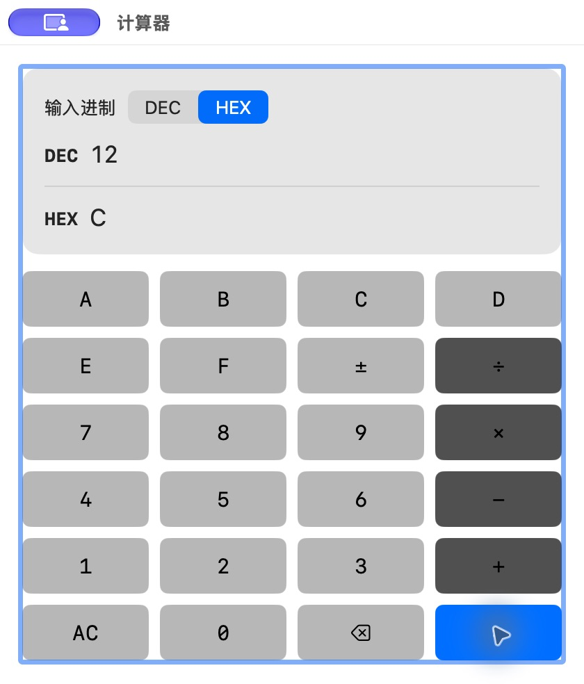

# 计算器十六进制结果

批次：C · 主搜索与工具核对。

进入路径：计算器 → HEX → A + 2 =。

状态：同时显示 DEC 12 / HEX C；随后 AC 清零并恢复 DEC。



## 源码定位

`zbox/Plugins/Calculator/Presentation/CalculatorView.swift:3`（当前工作区）。使用 SwiftUI 原生控件、系统语义颜色及字体；用户可见文案位于 `zbox/Localizable.xcstrings`。设置外层布局由 `zbox/Settings/SettingsView.swift` 管理。

以下为定位用摘录，可能截断组件并省略回调、服务依赖，不能独立运行：

```swift
struct CalculatorView: View {
    let calculator: CalculatorPlugin
    let close: () -> Void

    @FocusState private var acceptsKeyboardInput: Bool

    var body: some View {
        @Bindable var calculator = calculator

        VStack(spacing: 12) {
            VStack(alignment: .leading, spacing: 12) {
                Picker("Input Base", selection: $calculator.inputRadix) {
                    ForEach(CalculatorEngine.Radix.allCases, id: \.self) { radix in
                        Text(radix.shortTitle)
                            .tag(radix)
                            .accessibilityLabel(radix.accessibilityLabel)
                    }
                }
                .pickerStyle(.segmented)

                LabeledContent {
                    result(calculator.decimalText, label: String(localized: "Decimal value"))
                } label: {
                    Text("DEC").font(.headline.monospaced())
                }

                Divider()

                LabeledContent {
                    result(calculator.hexadecimalText, label: String(localized: "Hexadecimal value"))
                } label: {
                    Text("HEX").font(.headline.monospaced())
                }

```

版本及覆盖限制见 [总索引](index.md)。截图只包含当前可见区域。表单草稿均取消；公开示例仅用于本地转换，采集后清除，未复制结果或保存设置。
