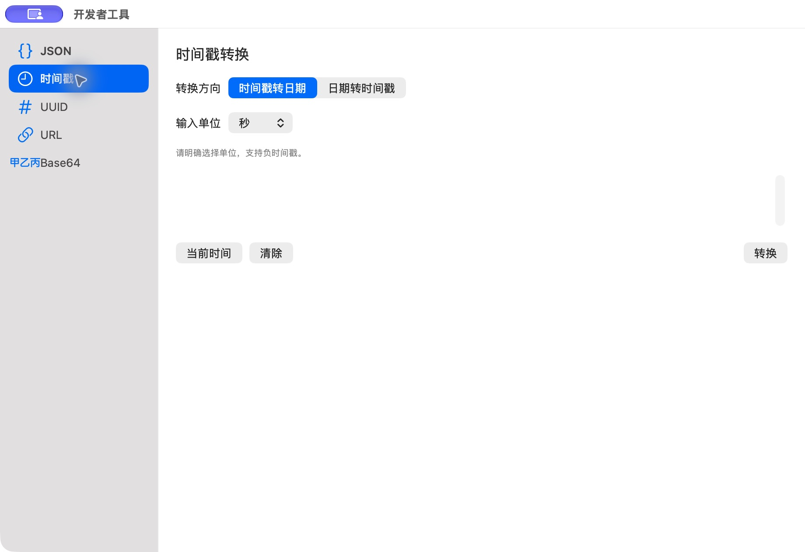

# 时间戳空输入

批次：C · 主搜索与工具核对。

进入路径：开发者工具 → 时间戳。

状态：输入为空。截图后源码已增加输入标签，此图为补正前。



## 源码定位

`zbox/Plugins/DeveloperTools/DeveloperTimestampView.swift:3`（当前工作区）。使用 SwiftUI 原生控件、系统语义颜色及字体；用户可见文案位于 `zbox/Localizable.xcstrings`。设置外层布局由 `zbox/Settings/SettingsView.swift` 管理。

以下为定位用摘录，可能截断组件并省略回调、服务依赖，不能独立运行：

```swift
struct DeveloperTimestampView: View {
    @Bindable var session: DeveloperTimestampSession
    let copy: (String) -> Void

    var body: some View {
        ScrollView {
            VStack(alignment: .leading, spacing: 16) {
                Picker("Direction", selection: $session.fromDate) {
                    Text("Timestamp to Date").tag(false)
                    Text("Date to Timestamp").tag(true)
                }.pickerStyle(.segmented)
                if !session.fromDate {
                    Picker("Input Unit", selection: $session.unit) {
                        ForEach(TimestampConverter.Unit.allCases, id: \.self) { unit in
                            Text(unit.title).tag(unit)
                        }
                    }.fixedSize()
                }
                Text(session.fromDate
                     ? String(localized: "Include Z or an explicit offset such as +08:00. Precision: up to milliseconds.")
                     : String(localized: "Units are explicit. Negative timestamps are supported."))
                    .font(.caption).foregroundStyle(.secondary)
                Text("Timestamp Input").font(.headline)
                PlainTextEditor(text: $session.input, label: String(localized: "Timestamp Input"))
                    .frame(height: 64)
                HStack {
                    Button("Current Time") { session.useCurrentTime() }
                    Button("Clear") { session.input = "" }
                    Spacer()
                    Button("Convert") { session.run() }
                        .keyboardShortcut(.return, modifiers: .command)
                }
                if let error = session.error {
                    Text(error).foregroundStyle(.red).textSelection(.enabled)
```

版本及覆盖限制见 [总索引](index.md)。截图只包含当前可见区域。表单草稿均取消；公开示例仅用于本地转换，采集后清除，未复制结果或保存设置。
