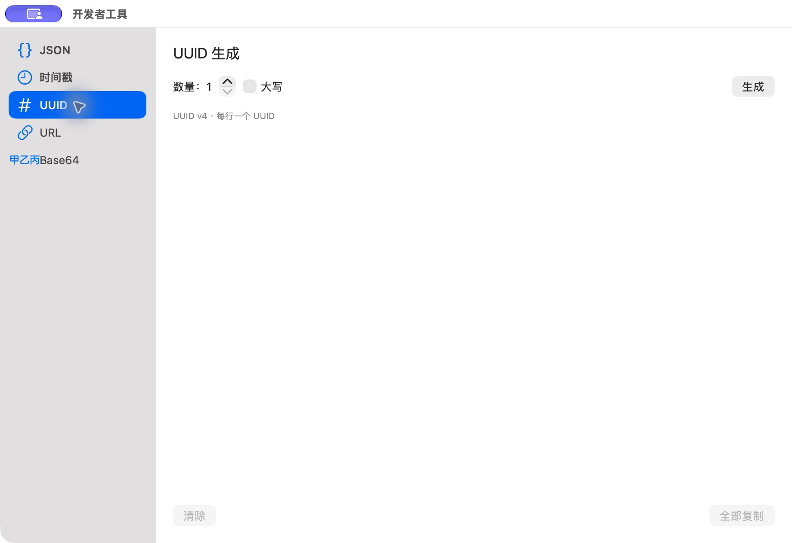

# UUID 空列表（补正前）

批次：C · 主搜索与工具核对。

进入路径：开发者工具 → UUID。

状态：未生成 UUID；此图揭示空状态缺少说明，源码随后已补正。



## 源码定位

`zbox/Plugins/DeveloperTools/DeveloperToolsView.swift:3`（当前工作区）。使用 SwiftUI 原生控件、系统语义颜色及字体；用户可见文案位于 `zbox/Localizable.xcstrings`。设置外层布局由 `zbox/Settings/SettingsView.swift` 管理。

以下为定位用摘录，可能截断组件并省略回调、服务依赖，不能独立运行：

```swift
struct DeveloperToolsView: View {
    @Bindable var plugin: DeveloperToolsPlugin

    var body: some View {
        HStack(spacing: 0) {
            List(DeveloperToolsPlugin.Tool.allCases, selection: $plugin.selection) { tool in
                Label(tool.sidebarTitle, systemImage: tool.icon).tag(tool)
            }
            .listStyle(.sidebar)
            .frame(width: 180)
            Divider()
            VStack(alignment: .leading, spacing: 16) {
                Text(plugin.selection.title).font(.title2)
                switch plugin.selection {
                case .json: DeveloperTextToolView(session: plugin.jsonSession, copy: plugin.copy).id(plugin.selection)
                case .timestamp: DeveloperTimestampView(session: plugin.timestampSession, copy: plugin.copy)
                case .uuid: uuidView
                case .url: DeveloperTextToolView(session: plugin.urlSession, copy: plugin.copy).id(plugin.selection)
                case .base64: DeveloperTextToolView(session: plugin.base64Session, copy: plugin.copy).id(plugin.selection)
                }
                if let error = plugin.copyError {
                    Text(error).foregroundStyle(.red).textSelection(.enabled)
                }
            }
            .padding(20)
            .frame(maxWidth: .infinity, maxHeight: .infinity, alignment: .topLeading)
        }
        .sheet(isPresented: Binding(get: { plugin.pendingSelection != nil }, set: { if !$0 { plugin.pendingSelection = nil } })) {
            VStack(alignment: .leading, spacing: 16) {
                Text("Import Selected Text").font(.headline)
                Picker("Tool", selection: $plugin.importTool) {
                    ForEach([DeveloperToolsPlugin.Tool.json, .url, .base64]) { tool in
                        Text(tool.title).tag(tool)
                    }
```

版本及覆盖限制见 [总索引](index.md)。截图只包含当前可见区域。表单草稿均取消；公开示例仅用于本地转换，采集后清除，未复制结果或保存设置。
