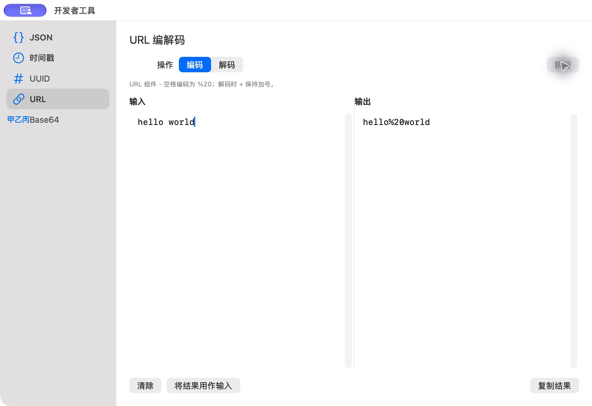

# URL 编码结果

批次：C · 主搜索与工具核对。

进入路径：开发者工具 → URL → 输入 hello world → 执行。

状态：结果为 hello%20world，随后清除，未打开 URL 或复制结果。



## 源码定位

`zbox/Plugins/DeveloperTools/DeveloperTextToolView.swift:3`（当前工作区）。使用 SwiftUI 原生控件、系统语义颜色及字体；用户可见文案位于 `zbox/Localizable.xcstrings`。设置外层布局由 `zbox/Settings/SettingsView.swift` 管理。

以下为定位用摘录，可能截断组件并省略回调、服务依赖，不能独立运行：

```swift
struct DeveloperTextToolView: View {
    @Bindable var session: DeveloperTextSession
    let copy: (String) -> Void
    @State private var selectionRequest: (id: UUID, offset: Int)?

    private var hint: String {
        switch session.kind {
        case .json: String(localized: "Standard JSON · Formatting preserves numbers, key order, and string escapes.")
        case .url: String(localized: "URL components · Spaces use %20; + stays a plus sign when decoding.")
        case .base64: String(localized: "UTF-8 text · Standard output is padded; URL-safe output omits padding.")
        }
    }

    var body: some View {
        VStack(alignment: .leading, spacing: 12) {
            HStack {
                if session.kind == .json {
                    Picker("Operation", selection: $session.jsonOperation) {
                        ForEach(JSONFormatter.Operation.allCases, id: \.self) { operation in
                            Text(operation.title).tag(operation)
                        }
                    }.pickerStyle(.segmented).frame(maxWidth: 280)
                    Picker("Indent", selection: $session.indentation) {
                        Text("2 spaces").tag(2)
                        Text("4 spaces").tag(4)
                    }.disabled(session.jsonOperation != .format)
                } else {
                    Picker("Operation", selection: $session.decoding) {
                        Text("Encode").tag(false)
                        Text("Decode").tag(true)
                    }.pickerStyle(.segmented).frame(maxWidth: 220)
                    if session.kind == .base64 {
                        Picker("Alphabet", selection: $session.urlSafe) {
                            Text("Standard Base64").tag(false)
```

版本及覆盖限制见 [总索引](index.md)。截图只包含当前可见区域。表单草稿均取消；公开示例仅用于本地转换，采集后清除，未复制结果或保存设置。
