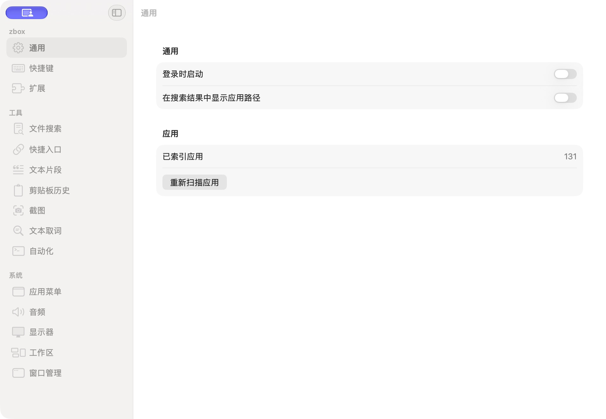

# 设置窗口缩放确认

批次：D · 最终修正核对。

进入路径：打开设置 → 用户手动拖动右边缘。

状态：用户确认可改变宽度；截图宽度从 1800 增至 1910 像素，布局正常，AX 缩放按钮恢复可用。运行包包含仅记录窗口属性的临时诊断，最终源码已移除日志，保留相同的延后设置时序。



## 源码定位

`zbox/Settings/SettingsView.swift:213`（当前工作区）。使用 SwiftUI 原生控件、系统语义颜色及字体；用户可见文案位于 `zbox/Localizable.xcstrings`。设置外层布局由 `zbox/Settings/SettingsView.swift` 管理。

以下为定位用摘录，可能截断组件并省略回调、服务依赖，不能独立运行：

```swift
private struct SettingsWindowConfiguration: NSViewRepresentable {
    func makeNSView(context: Context) -> WindowView { WindowView() }
    func updateNSView(_ nsView: WindowView, context: Context) {}

    final class WindowView: NSView {
        override func viewDidMoveToWindow() {
            super.viewDidMoveToWindow()
            guard let window else { return }
            window.toolbarStyle = .unifiedCompact
            DispatchQueue.main.async { [weak window] in
                window?.styleMask.insert(.resizable)
            }
        }
    }
}
```

版本及覆盖限制见 [总索引](index.md)。截图只包含当前可见区域。表单草稿均取消；公开示例仅用于本地转换，采集后清除，未复制结果或保存设置。
