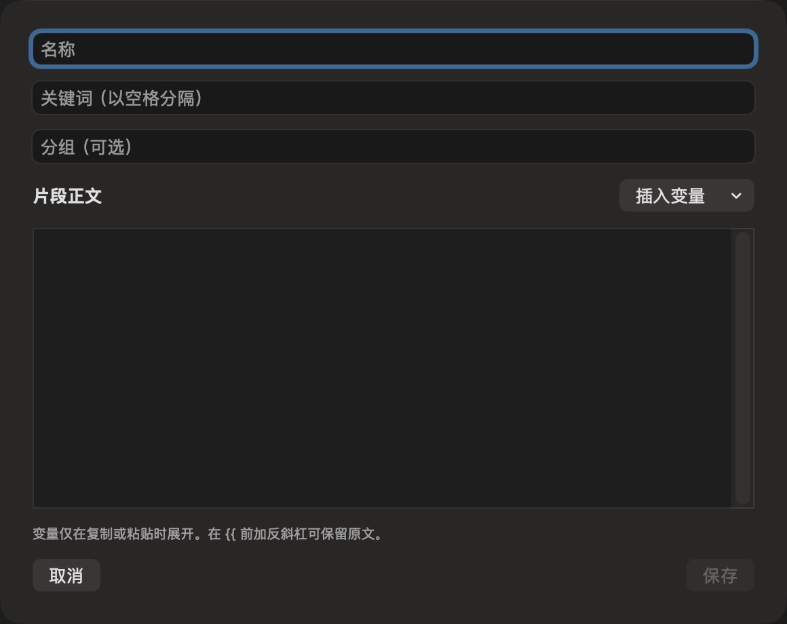

# 新增文本片段表单（当前 dev，深色）

批次：E · 2026-10-31 最新 dev 重建采集。

进入路径：设置 → 文本片段 → 添加文本片段。

状态：空白表单；截图后取消，未保存。



## 版本与操作范围

源码：`2f41c6ae55fecb5a316ed765141276e671973a8d`，已通过 `git pull --ff-only origin dev` 核实远端无更新。运行包：`/private/tmp/zbox-ui-capture-build/Build/Products/Debug/zbox.app`，由本次源码构建，macOS Debug build 通过；未修改产品源码。应用版本 1.0，构建号 1。深色外观来自当前系统设置，本轮没有切换外观。

保留工具返回的完整窗口/表单尺寸，未裁切或拼接。截图工具返回 JPEG，已使用 sips 转为真实 PNG，未缩放；转换不会恢复 JPEG 已损失的细节。紫色共享标记和指针属于采集环境。只记录可见内容，不代表功能验收通过。只导航、观察及取消临时表单，未启用插件或采集、授予权限、保存条目、执行脚本或上传。

## 源码定位

`zbox/Plugins/Snippets/SnippetsSettingsView.swift:54`。设置外层：`zbox/Settings/SettingsView.swift:3`；中文文案：`zbox/Localizable.xcstrings`。使用系统语义颜色、字体和原生控件。

以下为起始布局定位摘录，可能在组件中途截断，并省略其余子视图和回调实现，不能独立编译或运行：

```swift
private struct SnippetEditor: View {
    @Environment(\.dismiss) private var dismiss
    @State var item: Snippet
    let save: (Snippet) -> Bool
    @State private var error: String?
    @State private var selection: TextSelection?
    @FocusState private var bodyFocused: Bool

    private func insert(_ token: String) {
        let range: Range<String.Index>
        if let selection, case .selection(let selectedRange) = selection.indices { range = selectedRange }
        else { range = item.body.endIndex..<item.body.endIndex }
        let offset = item.body.distance(from: item.body.startIndex, to: range.lowerBound)
        item.body.replaceSubrange(range, with: token)
        let cursor = item.body.index(item.body.startIndex, offsetBy: offset + token.count)
        selection = TextSelection(insertionPoint: cursor)
        bodyFocused = true
    }

    var body: some View {
        VStack(alignment: .leading, spacing: 12) {
            TextField("Name", text: $item.name)
            TextField("Keywords (separated by spaces)", text: $item.keywords)
            TextField("Group (optional)", text: $item.group)
```
