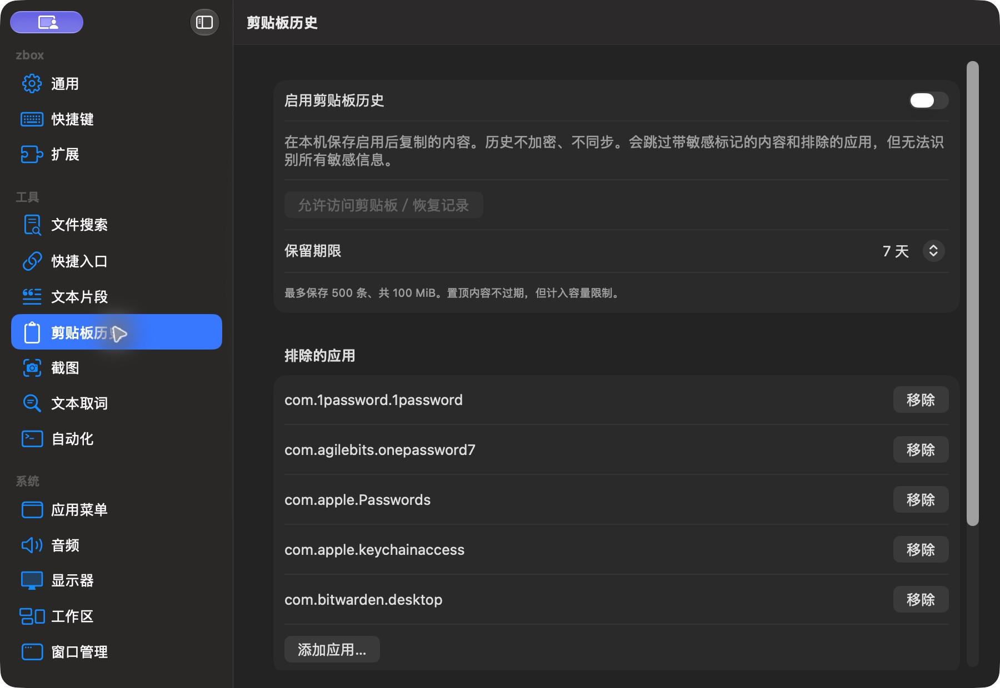

# 剪贴板历史设置（当前 dev，深色）

批次：E · 2026-10-31 最新 dev 重建采集。

进入路径：设置 → 剪贴板历史。

状态：采集关闭，保留期限为 7 天；仅记录首屏，下方权限和清空按钮未进入截图。



## 版本与操作范围

源码：`2f41c6ae55fecb5a316ed765141276e671973a8d`，已通过 `git pull --ff-only origin dev` 核实远端无更新。运行包：`/private/tmp/zbox-ui-capture-build/Build/Products/Debug/zbox.app`，由本次源码构建，macOS Debug build 通过；未修改产品源码。应用版本 1.0，构建号 1。深色外观来自当前系统设置，本轮没有切换外观。

保留工具返回的完整窗口/表单尺寸，未裁切或拼接。截图工具返回 JPEG，已使用 sips 转为真实 PNG，未缩放；转换不会恢复 JPEG 已损失的细节。紫色共享标记和指针属于采集环境。只记录可见内容，不代表功能验收通过。只导航、观察及取消临时表单，未启用插件或采集、授予权限、保存条目、执行脚本或上传。

## 源码定位

`zbox/Plugins/ClipboardHistory/ClipboardHistoryView.swift:73`。设置外层：`zbox/Settings/SettingsView.swift:3`；中文文案：`zbox/Localizable.xcstrings`。使用系统语义颜色、字体和原生控件。

以下为起始布局定位摘录，可能在组件中途截断，并省略其余子视图和回调实现，不能独立编译或运行：

```swift
struct ClipboardHistorySettingsView: View {
    @Bindable var plugin: ClipboardHistoryPlugin
    let onEnabledChanged: @MainActor @Sendable (Bool) -> Void
    let shortcutError: String?
    @State private var confirmsClear = false

    var body: some View {
        Form {
            Toggle("Enable Clipboard History", isOn: Binding(get: { plugin.isEnabled }, set: onEnabledChanged))
            Text("Stores future copies on this Mac. History is not encrypted or synced. Sensitive markers and excluded apps are skipped, but not all secrets can be detected.")
                .foregroundStyle(.secondary)
            if let message = plugin.statusMessage { Text(message).foregroundStyle(.secondary) }
            if let shortcutError { SettingsErrorView(message: shortcutError) }
            Button("Allow Clipboard Access / Resume", action: plugin.requestClipboardAccess)
                .disabled(!plugin.isEnabled || plugin.isRecording)
            Picker("Keep History", selection: $plugin.retentionDays) {
                Text("1 Day").tag(1)
                Text("7 Days").tag(7)
                Text("30 Days").tag(30)
            }
            Text("Up to 500 items and 100 MiB. Pinned items do not expire but count toward the limit.")
                .font(.caption).foregroundStyle(.secondary)
            Section("Excluded Applications") {
                ForEach(plugin.excludedApplications.sorted(), id: \.self) { id in
```
