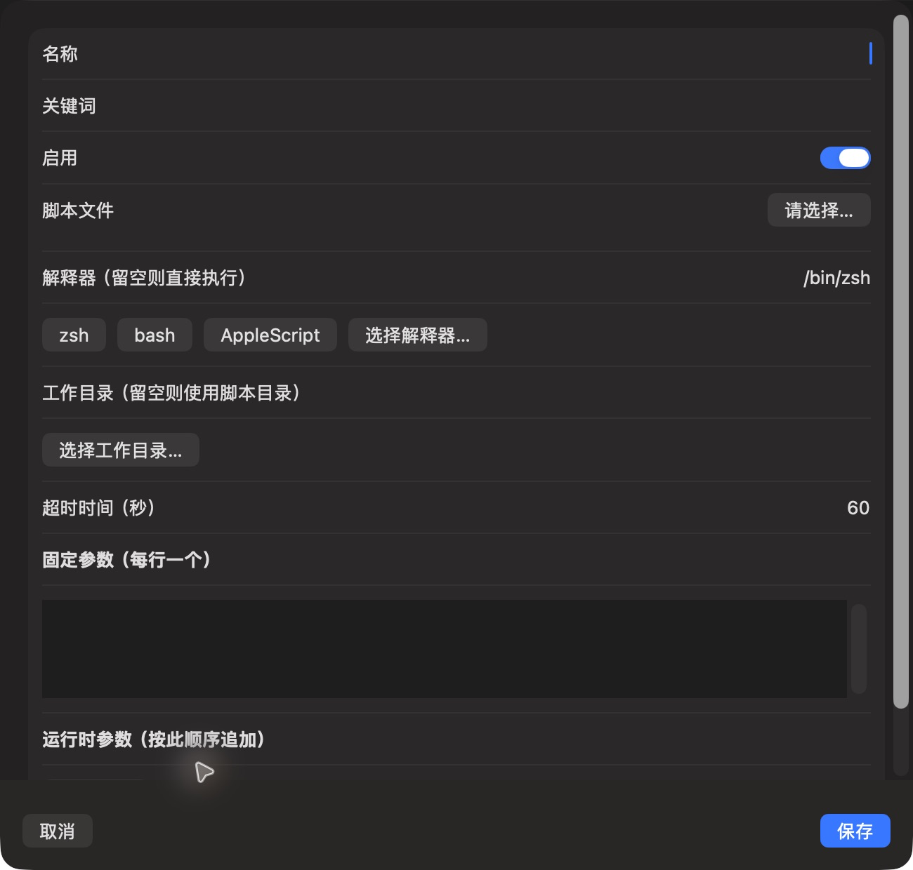

# 新增脚本表单（当前 dev，深色）

批次：E · 2026-10-31 最新 dev 重建采集。

进入路径：设置 → 自动化 → 添加脚本。

状态：空白表单首屏，解释器默认 /bin/zsh、超时 60 秒；运行时参数下方尚未展开采集。截图后取消，未保存或运行脚本。



## 版本与操作范围

源码：`2f41c6ae55fecb5a316ed765141276e671973a8d`，已通过 `git pull --ff-only origin dev` 核实远端无更新。运行包：`/private/tmp/zbox-ui-capture-build/Build/Products/Debug/zbox.app`，由本次源码构建，macOS Debug build 通过；未修改产品源码。应用版本 1.0，构建号 1。深色外观来自当前系统设置，本轮没有切换外观。

保留工具返回的完整窗口/表单尺寸，未裁切或拼接。截图工具返回 JPEG，已使用 sips 转为真实 PNG，未缩放；转换不会恢复 JPEG 已损失的细节。紫色共享标记和指针属于采集环境。只记录可见内容，不代表功能验收通过。只导航、观察及取消临时表单，未启用插件或采集、授予权限、保存条目、执行脚本或上传。

## 源码定位

`zbox/Plugins/ScriptCommands/ScriptCommandsSettingsView.swift:45`。设置外层：`zbox/Settings/SettingsView.swift:3`；中文文案：`zbox/Localizable.xcstrings`。使用系统语义颜色、字体和原生控件。

以下为起始布局定位摘录，可能在组件中途截断，并省略其余子视图和回调实现，不能独立编译或运行：

```swift
private struct ScriptCommandEditor: View {
    @Environment(\.dismiss) private var dismiss
    @State var item: ScriptCommand
    let save: (ScriptCommand) -> Bool
    @State private var error: String?
    @State private var shortcuts: [AppleShortcutEntry] = []
    @State private var isLoading = false
    @State private var refreshID = UUID()

    var body: some View {
        VStack {
            Form {
                TextField("Name", text: $item.name)
                TextField("Keywords", text: $item.keywords)
                Toggle("Enabled", isOn: $item.enabled)
                if item.shortcut != nil {
                    Picker("Apple Shortcut", selection: Binding(get: { item.shortcut?.identifier }, set: { id in
                        if let entry = shortcuts.first(where: { $0.id == id }) {
                            item.shortcut?.identifier = entry.id
                            item.shortcut?.name = entry.name
                            if item.name.isEmpty { item.name = entry.name }
                        }
                    })) {
                        if let current = item.shortcut, !shortcuts.contains(where: { $0.id == current.identifier }) {
```
