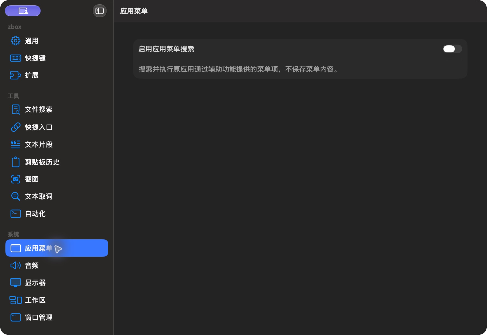

# 应用菜单设置（当前 dev，深色）

批次：E · 2026-10-31 最新 dev 重建采集。

进入路径：设置 → 应用菜单。

状态：功能关闭，显示菜单读取范围说明。



## 版本与操作范围

源码：`2f41c6ae55fecb5a316ed765141276e671973a8d`，已通过 `git pull --ff-only origin dev` 核实远端无更新。运行包：`/private/tmp/zbox-ui-capture-build/Build/Products/Debug/zbox.app`，由本次源码构建，macOS Debug build 通过；未修改产品源码。应用版本 1.0，构建号 1。深色外观来自当前系统设置，本轮没有切换外观。

保留工具返回的完整窗口/表单尺寸，未裁切或拼接。截图工具返回 JPEG，已使用 sips 转为真实 PNG，未缩放；转换不会恢复 JPEG 已损失的细节。紫色共享标记和指针属于采集环境。只记录可见内容，不代表功能验收通过。只导航、观察及取消临时表单，未启用插件或采集、授予权限、保存条目、执行脚本或上传。

## 源码定位

`zbox/Plugins/AppMenu/AppMenuPlugin.swift:152`。设置外层：`zbox/Settings/SettingsView.swift:3`；中文文案：`zbox/Localizable.xcstrings`。使用系统语义颜色、字体和原生控件。

以下为起始布局定位摘录，可能在组件中途截断，并省略其余子视图和回调实现，不能独立编译或运行：

```swift
struct AppMenuSettingsView: View {
    let environment: AppEnvironment
    var body: some View {
        Form {
            Toggle("Enable Application Menu Search", isOn: Binding(get: { environment.appMenuPlugin.isEnabled }, set: environment.setAppMenuEnabled))
            Text("Search and execute the original application's accessible menu items. Menu contents are not saved.").foregroundStyle(.secondary)
            if !environment.isAccessibilityTrusted {
                Button("Request Accessibility Permission", action: environment.requestAccessibilityPermission)
                Button("Open Accessibility Settings", action: environment.openAccessibilitySettings)
            }
            if let message = environment.appMenuPlugin.statusMessage { SettingsErrorView(message: message) }
            if let message = environment.shortcutRegistrationError { SettingsErrorView(message: message) }
        }.settingsPane()
    }
}
```
