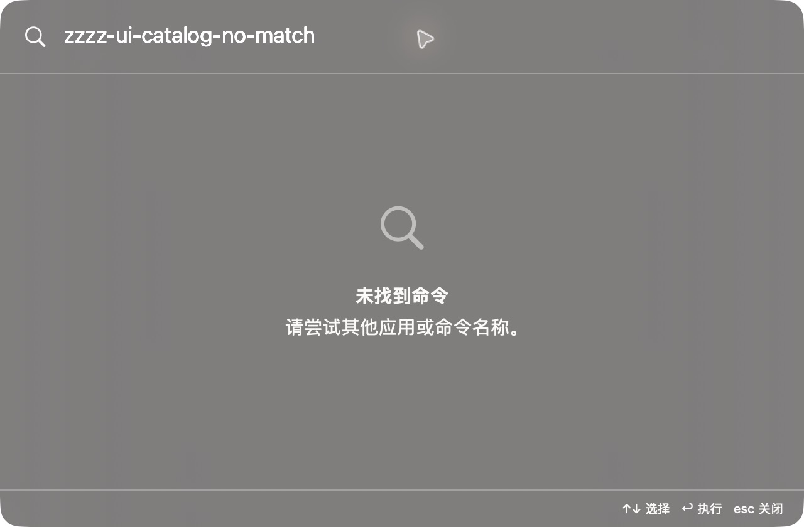

# 主搜索无匹配（临时采集构建）

批次：F · 2026-10-31 临时放宽主搜索失焦隐藏的采集构建。

进入路径：主搜索 → 输入无匹配文本。

状态：输入 zzzz-ui-catalog-no-match，显示无匹配提示；之后已替换该临时查询。



## 版本与操作边界

基于远端 dev `2f41c6ae55fecb5a316ed765141276e671973a8d`，版本 1.0（1）。运行包 `/private/tmp/zbox-ui-capture-build/Build/Products/Debug/zbox.app`。用户授权临时取消 `windowDidResignKey` 中的隐藏，并设置 `hidesOnDeactivate = false`；这仅为捕获真实运行界面，不能用来证明正常版本的失焦、焦点恢复或跨应用行为。最终恢复情况见索引。

只保存当前可见区域，工具 JPEG 已转为真实 PNG，未缩放、拼接或重绘。系统为深色外观；透明主搜索在工具截图中呈灰色，不能据此评估其桌面背景合成效果。临时输入和公开样例仅在本机使用，不复制结果或上传；操作收尾见状态及索引。

## 源码定位

`zbox/Search/RootSearchView.swift:3`，文案位于 `zbox/Localizable.xcstrings`。以下仅为布局起始摘录，可能截断组件，省略其余依赖和回调，不能独立运行。

```swift
struct RootSearchView: View {
    let environment: AppEnvironment

    @FocusState private var isSearchFocused: Bool

    var body: some View {
        @Bindable var environment = environment
        let results = environment.searchResults
        let selectedID = environment.selectedCommandID ?? results.first?.id

        VStack(spacing: 0) {
            HStack(spacing: 12) {
                Image(systemName: "magnifyingglass")
                    .foregroundStyle(.secondary)
                    .accessibilityHidden(true)
                TextField("Search apps and commands", text: $environment.searchQuery)
                    .textFieldStyle(.plain)
                    .focused($isSearchFocused)
            }
            .font(.title2)
            .padding(18)

            Divider()
```
