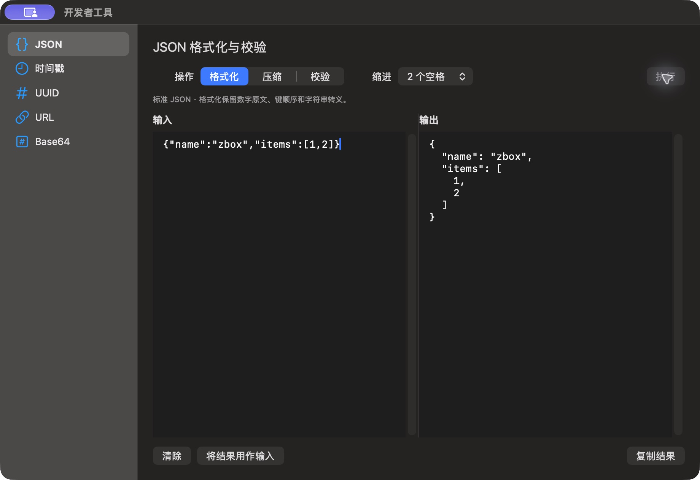

# JSON 格式化结果

批次：F · 2026-10-31 临时放宽主搜索失焦隐藏的采集构建。

进入路径：开发者工具 → JSON → 输入公开样例 → 执行。

状态：公开样例格式化结果，之后点击清除并观察输入输出均为空。



## 版本与操作边界

基于远端 dev `2f41c6ae55fecb5a316ed765141276e671973a8d`，版本 1.0（1）。运行包 `/private/tmp/zbox-ui-capture-build/Build/Products/Debug/zbox.app`。用户授权临时取消 `windowDidResignKey` 中的隐藏，并设置 `hidesOnDeactivate = false`；这仅为捕获真实运行界面，不能用来证明正常版本的失焦、焦点恢复或跨应用行为。最终恢复情况见索引。

只保存当前可见区域，工具 JPEG 已转为真实 PNG，未缩放、拼接或重绘。系统为深色外观；透明主搜索在工具截图中呈灰色，不能据此评估其桌面背景合成效果。临时输入和公开样例仅在本机使用，不复制结果或上传；操作收尾见状态及索引。

## 源码定位

`zbox/Plugins/DeveloperTools/DeveloperTextToolView.swift:16`，文案位于 `zbox/Localizable.xcstrings`。以下仅为布局起始摘录，可能截断组件，省略其余依赖和回调，不能独立运行。

```swift
    var body: some View {
        VStack(alignment: .leading, spacing: 12) {
            HStack {
                if session.kind == .json {
                    Picker("Operation", selection: $session.jsonOperation) {
                        ForEach(JSONFormatter.Operation.allCases, id: \.self) { operation in
                            Text(operation.title).tag(operation)
                        }
                    }.pickerStyle(.segmented).frame(maxWidth: 280)
                    Picker("Indent", selection: $session.indentation) {
                        Text("2 spaces").tag(2)
                        Text("4 spaces").tag(4)
                    }.disabled(session.jsonOperation != .format)
                } else {
                    Picker("Operation", selection: $session.decoding) {
                        Text("Encode").tag(false)
                        Text("Decode").tag(true)
                    }.pickerStyle(.segmented).frame(maxWidth: 220)
                    if session.kind == .base64 {
                        Picker("Alphabet", selection: $session.urlSafe) {
                            Text("Standard Base64").tag(false)
                            Text("URL-safe Base64").tag(true)
                        }.labelsHidden()
```
