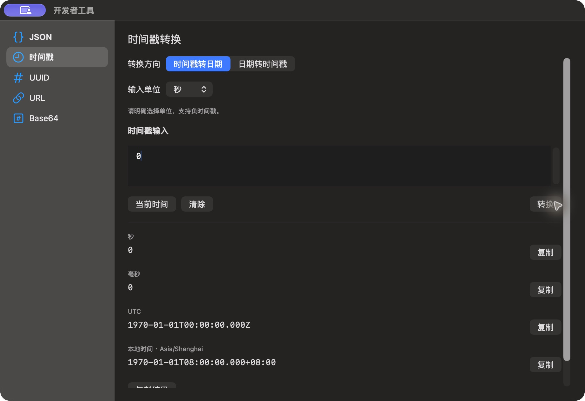

# 时间戳转换结果

批次：F · 2026-10-31 临时放宽主搜索失焦隐藏的采集构建。

进入路径：开发者工具 → 时间戳 → 输入 0 → 转换。

状态：输入 0 秒，展示 Unix 起点的 UTC 与本地时间；底部复制说明未完全进入截图，之后已清除输入结果。



## 版本与操作边界

基于远端 dev `2f41c6ae55fecb5a316ed765141276e671973a8d`，版本 1.0（1）。运行包 `/private/tmp/zbox-ui-capture-build/Build/Products/Debug/zbox.app`。用户授权临时取消 `windowDidResignKey` 中的隐藏，并设置 `hidesOnDeactivate = false`；这仅为捕获真实运行界面，不能用来证明正常版本的失焦、焦点恢复或跨应用行为。最终恢复情况见索引。

只保存当前可见区域，工具 JPEG 已转为真实 PNG，未缩放、拼接或重绘。系统为深色外观；透明主搜索在工具截图中呈灰色，不能据此评估其桌面背景合成效果。临时输入和公开样例仅在本机使用，不复制结果或上传；操作收尾见状态及索引。

## 源码定位

`zbox/Plugins/DeveloperTools/DeveloperTimestampView.swift:7`，文案位于 `zbox/Localizable.xcstrings`。以下仅为布局起始摘录，可能截断组件，省略其余依赖和回调，不能独立运行。

```swift
    var body: some View {
        ScrollView {
            VStack(alignment: .leading, spacing: 16) {
                Picker("Direction", selection: $session.fromDate) {
                    Text("Timestamp to Date").tag(false)
                    Text("Date to Timestamp").tag(true)
                }.pickerStyle(.segmented)
                if !session.fromDate {
                    Picker("Input Unit", selection: $session.unit) {
                        ForEach(TimestampConverter.Unit.allCases, id: \.self) { unit in
                            Text(unit.title).tag(unit)
                        }
                    }.fixedSize()
                }
                Text(session.fromDate
                     ? String(localized: "Include Z or an explicit offset such as +08:00. Precision: up to milliseconds.")
                     : String(localized: "Units are explicit. Negative timestamps are supported."))
                    .font(.caption).foregroundStyle(.secondary)
                Text("Timestamp Input").font(.headline)
                PlainTextEditor(text: $session.input, label: String(localized: "Timestamp Input"))
                    .frame(height: 64)
                HStack {
                    Button("Current Time") { session.useCurrentTime() }
```
