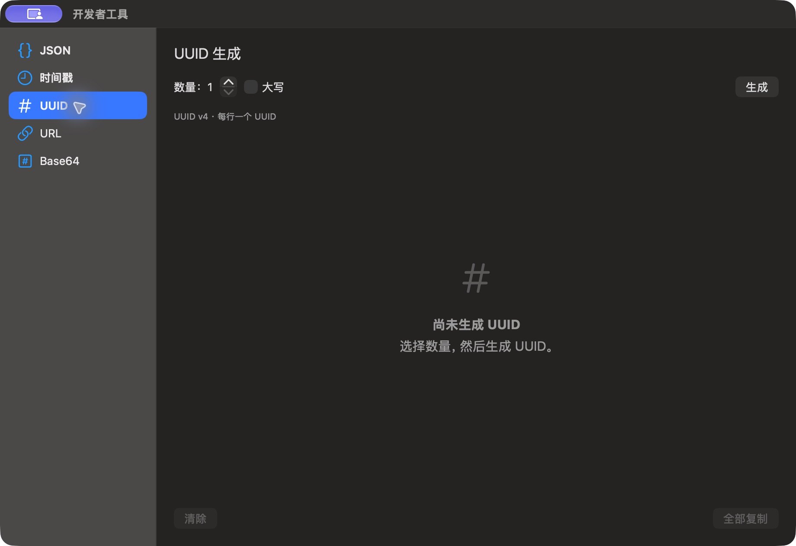

# UUID 空状态

批次：F · 2026-10-31 临时放宽主搜索失焦隐藏的采集构建。

进入路径：开发者工具 → UUID。

状态：初始 UUID 列表为空，数量为 1。



## 版本与操作边界

基于远端 dev `2f41c6ae55fecb5a316ed765141276e671973a8d`，版本 1.0（1）。运行包 `/private/tmp/zbox-ui-capture-build/Build/Products/Debug/zbox.app`。用户授权临时取消 `windowDidResignKey` 中的隐藏，并设置 `hidesOnDeactivate = false`；这仅为捕获真实运行界面，不能用来证明正常版本的失焦、焦点恢复或跨应用行为。最终恢复情况见索引。

只保存当前可见区域，工具 JPEG 已转为真实 PNG，未缩放、拼接或重绘。系统为深色外观；透明主搜索在工具截图中呈灰色，不能据此评估其桌面背景合成效果。临时输入和公开样例仅在本机使用，不复制结果或上传；操作收尾见状态及索引。

## 源码定位

`zbox/Plugins/DeveloperTools/DeveloperToolsView.swift:54`，文案位于 `zbox/Localizable.xcstrings`。以下仅为布局起始摘录，可能截断组件，省略其余依赖和回调，不能独立运行。

```swift
    private var uuidView: some View {
        VStack(alignment: .leading, spacing: 16) {
            HStack {
                Stepper("Count: \(plugin.uuidCount)", value: $plugin.uuidCount, in: 1...100)
                    .fixedSize()
                Toggle("Uppercase", isOn: $plugin.uppercaseUUIDs)
                Spacer()
                Button("Generate") { plugin.generateUUIDs() }
                    .keyboardShortcut(.return, modifiers: .command)
            }
            Text("UUID v4 · One UUID per line")
                .font(.caption).foregroundStyle(.secondary)
            List(plugin.uuids, id: \.self) { uuid in
                HStack {
                    Text(plugin.uuidText(uuid)).font(.system(.body, design: .monospaced))
                        .textSelection(.enabled)
                    Spacer()
                    Button("Copy") { plugin.copy(plugin.uuidText(uuid)) }
                }
            }
            .overlay {
                if plugin.uuids.isEmpty {
                    ContentUnavailableView("No UUIDs Yet", systemImage: "number",
```
