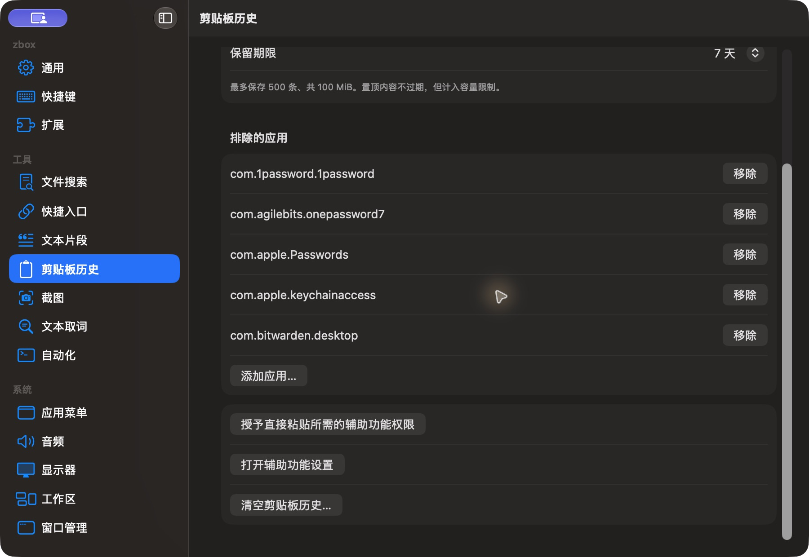

# 剪贴板历史设置底部

批次：F · 2026-10-31 临时放宽主搜索失焦隐藏的采集构建。

进入路径：设置 → 剪贴板历史 → 向下滚动。

状态：补齐排除应用、权限入口与清空按钮；没有启用采集、清空或请求权限。



## 版本与操作边界

基于远端 dev `2f41c6ae55fecb5a316ed765141276e671973a8d`，版本 1.0（1）。运行包 `/private/tmp/zbox-ui-capture-build/Build/Products/Debug/zbox.app`。用户授权临时取消 `windowDidResignKey` 中的隐藏，并设置 `hidesOnDeactivate = false`；这仅为捕获真实运行界面，不能用来证明正常版本的失焦、焦点恢复或跨应用行为。最终恢复情况见索引。

只保存当前可见区域，工具 JPEG 已转为真实 PNG，未缩放、拼接或重绘。系统为深色外观；透明主搜索在工具截图中呈灰色，不能据此评估其桌面背景合成效果。临时输入和公开样例仅在本机使用，不复制结果或上传；操作收尾见状态及索引。

## 源码定位

`zbox/Plugins/ClipboardHistory/ClipboardHistoryView.swift:73`，文案位于 `zbox/Localizable.xcstrings`。以下仅为布局起始摘录，可能截断组件，省略其余依赖和回调，不能独立运行。

```swift
struct ClipboardHistorySettingsView: View {
    @Bindable var plugin: ClipboardHistoryPlugin
    let onEnabledChanged: @MainActor @Sendable (Bool) -> Void
    let shortcutError: String?
    @State private var confirmsClear = false

    var body: some View {
        Form {
            Toggle("Enable Clipboard History", isOn: Binding(get: { plugin.isEnabled }, set: onEnabledChanged))
            Text("Stores future copies on this Mac. History is not encrypted or synced. Sensitive markers and excluded apps are skipped, but not all secrets can be detected.")
                .foregroundStyle(.secondary)
            if let message = plugin.statusMessage { Text(message).foregroundStyle(.secondary) }
            if let shortcutError { SettingsErrorView(message: shortcutError) }
            Button("Allow Clipboard Access / Resume", action: plugin.requestClipboardAccess)
                .disabled(!plugin.isEnabled || plugin.isRecording)
            Picker("Keep History", selection: $plugin.retentionDays) {
                Text("1 Day").tag(1)
                Text("7 Days").tag(7)
                Text("30 Days").tag(30)
            }
            Text("Up to 500 items and 100 MiB. Pinned items do not expire but count toward the limit.")
                .font(.caption).foregroundStyle(.secondary)
            Section("Excluded Applications") {
```
