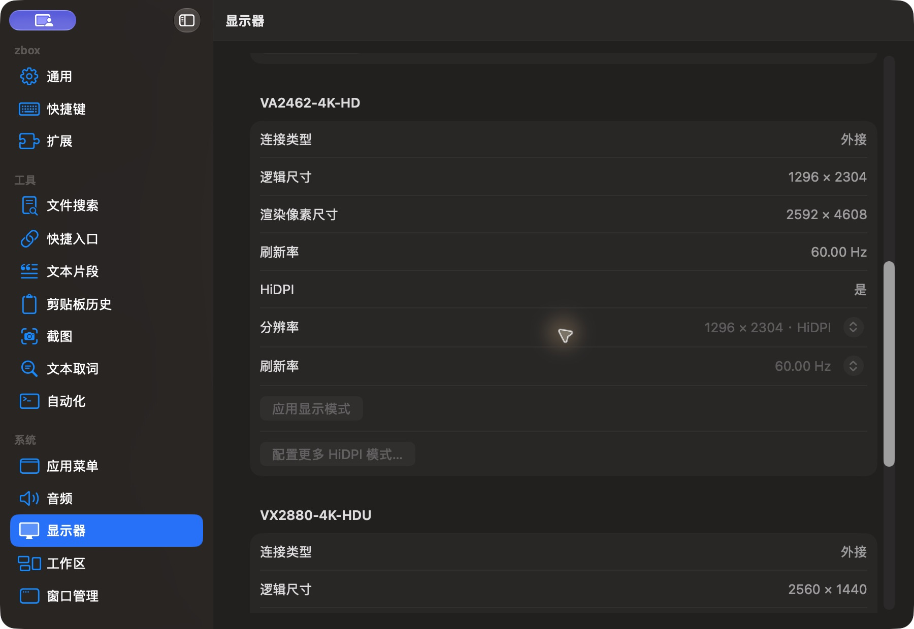

# 显示器设置中部

批次：F · 2026-10-31 临时放宽主搜索失焦隐藏的采集构建。

进入路径：设置 → 显示器 → 向下滚动一页。

状态：显示第一台外接显示器详情及禁用的模式控件；未修改显示器配置。



## 版本与操作边界

基于远端 dev `2f41c6ae55fecb5a316ed765141276e671973a8d`，版本 1.0（1）。运行包 `/private/tmp/zbox-ui-capture-build/Build/Products/Debug/zbox.app`。用户授权临时取消 `windowDidResignKey` 中的隐藏，并设置 `hidesOnDeactivate = false`；这仅为捕获真实运行界面，不能用来证明正常版本的失焦、焦点恢复或跨应用行为。最终恢复情况见索引。

只保存当前可见区域，工具 JPEG 已转为真实 PNG，未缩放、拼接或重绘。系统为深色外观；透明主搜索在工具截图中呈灰色，不能据此评估其桌面背景合成效果。临时输入和公开样例仅在本机使用，不复制结果或上传；操作收尾见状态及索引。

## 源码定位

`zbox/Plugins/Display/DisplaySettingsView.swift:3`，文案位于 `zbox/Localizable.xcstrings`。以下仅为布局起始摘录，可能截断组件，省略其余依赖和回调，不能独立运行。

```swift
struct DisplaySettingsView: View {
    let environment: AppEnvironment
    @State private var editingPreset: DisplayPreset?
    @State private var configuringHiDPI: DisplayInfo?
    @State private var removingHiDPI: DisplayHiDPIInstallation?

    var body: some View {
        let plugin = environment.displayPlugin
        Form {
            Section {
                Toggle("Enable Display", isOn: Binding(get: { plugin.isEnabled }, set: environment.setDisplayEnabled))
                    .disabled(plugin.hiDPI.isBusy)
                Button("Refresh Displays", action: plugin.refresh)
                if let message = plugin.statusMessage { Text(message).font(.caption) }
            }
            Section("Display Presets") {
                Button("Save Current Display Preset") { editingPreset = plugin.snapshot() }
                    .disabled(!plugin.isEnabled || plugin.displays.isEmpty || plugin.change.pending != nil)
                if let error = plugin.presets.errorMessage { SettingsErrorView(message: error) }
                ForEach(plugin.presets.presets) { preset in
                    HStack {
                        Text(preset.name).lineLimit(1).help(preset.name)
                        Spacer()
```
