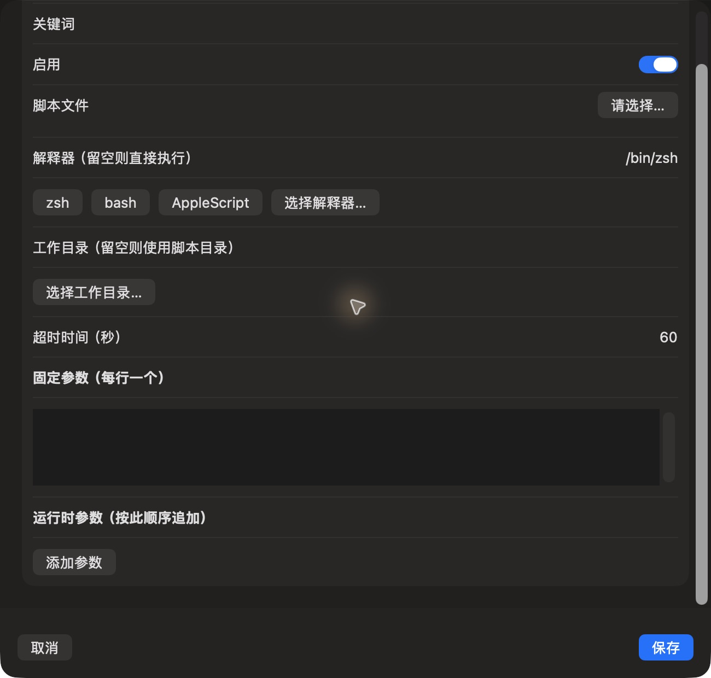

# 脚本表单底部

批次：F · 2026-10-31 临时放宽主搜索失焦隐藏的采集构建。

进入路径：设置 → 自动化 → 添加脚本 → 滚动到底部。

状态：补齐运行时参数和添加参数按钮；空白表单已取消，未保存或运行。



## 版本与操作边界

基于远端 dev `2f41c6ae55fecb5a316ed765141276e671973a8d`，版本 1.0（1）。运行包 `/private/tmp/zbox-ui-capture-build/Build/Products/Debug/zbox.app`。用户授权临时取消 `windowDidResignKey` 中的隐藏，并设置 `hidesOnDeactivate = false`；这仅为捕获真实运行界面，不能用来证明正常版本的失焦、焦点恢复或跨应用行为。最终恢复情况见索引。

只保存当前可见区域，工具 JPEG 已转为真实 PNG，未缩放、拼接或重绘。系统为深色外观；透明主搜索在工具截图中呈灰色，不能据此评估其桌面背景合成效果。临时输入和公开样例仅在本机使用，不复制结果或上传；操作收尾见状态及索引。

## 源码定位

`zbox/Plugins/ScriptCommands/ScriptCommandsSettingsView.swift:45`，文案位于 `zbox/Localizable.xcstrings`。以下仅为布局起始摘录，可能截断组件，省略其余依赖和回调，不能独立运行。

```swift
private struct ScriptCommandEditor: View {
    @Environment(\.dismiss) private var dismiss
    @State var item: ScriptCommand
    let save: (ScriptCommand) -> Bool
    @State private var error: String?
    @State private var shortcuts: [AppleShortcutEntry] = []
    @State private var isLoading = false
    @State private var refreshID = UUID()

    var body: some View {
        VStack {
            Form {
                TextField("Name", text: $item.name)
                TextField("Keywords", text: $item.keywords)
                Toggle("Enabled", isOn: $item.enabled)
                if item.shortcut != nil {
                    Picker("Apple Shortcut", selection: Binding(get: { item.shortcut?.identifier }, set: { id in
                        if let entry = shortcuts.first(where: { $0.id == id }) {
                            item.shortcut?.identifier = entry.id
                            item.shortcut?.name = entry.name
                            if item.name.isEmpty { item.name = entry.name }
                        }
                    })) {
```
