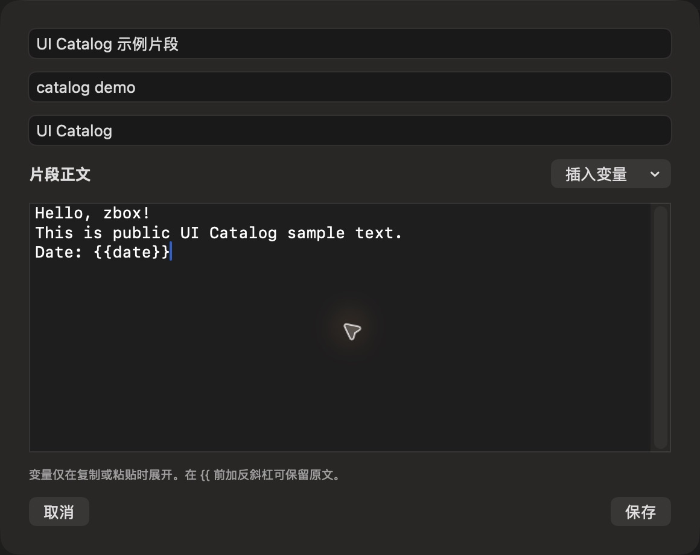

# 文本片段编辑（公开样例）

批次：G · 2026-10-31，正常 dev 构建。

进入路径：设置 → 文本片段 → 添加文本片段。

状态及操作：填写公开正文和日期变量，随后保存 UI Catalog 示例片段。



## 版本和范围

源码 dev `2f41c6ae55fecb5a316ed765141276e671973a8d`，版本 1.0（1），运行包 `/private/tmp/zbox-ui-capture-build/Build/Products/Debug/zbox.app`。主搜索正常失焦关闭。深色外观，仅当前可见窗口；截图转换为真实 PNG，未缩放或重绘。功能启停和测试数据收尾见总索引。

## 源码定位

`zbox/Plugins/Snippets/SnippetsSettingsView.swift:73`。文案资源为 `zbox/Localizable.xcstrings`。以下是局部 UI 摘录，省略其他依赖和回调，不能独立运行。

```swift
    var body: some View {
        VStack(alignment: .leading, spacing: 12) {
            TextField("Name", text: $item.name)
            TextField("Keywords (separated by spaces)", text: $item.keywords)
            TextField("Group (optional)", text: $item.group)
            HStack {
                Text("Snippet Text").font(.headline)
                Spacer()
                Menu("Insert Variable") {
                    Button("Date (yyyy-MM-dd)") { insert("{{date}}") }
                    Button("Time (HH:mm)") { insert("{{time}}") }
                    Button("Clipboard Text") { insert("{{clipboard}}") }
                }
            }
            TextEditor(text: $item.body, selection: $selection)
                .focused($bodyFocused)
                .font(.system(.body, design: .monospaced))
                .accessibilityLabel("Snippet Text")
                .border(.quaternary)
            Text("Variables expand only when copied or pasted. Prefix {{ with a backslash to keep it literal.").font(.caption).foregroundStyle(.secondary)
            if let error { SettingsErrorView(message: error) }
```
