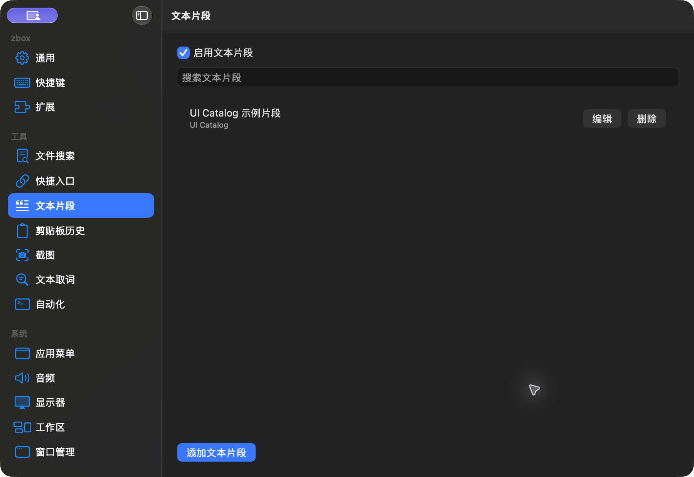

# 文本片段有内容列表

批次：G · 2026-10-31，正常 dev 构建。

进入路径：设置 → 文本片段。

状态及操作：保留已保存的 UI Catalog 示例片段，未复制或粘贴到其他应用。



## 版本和范围

源码 dev `2f41c6ae55fecb5a316ed765141276e671973a8d`，版本 1.0（1），运行包 `/private/tmp/zbox-ui-capture-build/Build/Products/Debug/zbox.app`。主搜索正常失焦关闭。深色外观，仅当前可见窗口；截图转换为真实 PNG，未缩放或重绘。功能启停和测试数据收尾见总索引。

## 源码定位

`zbox/Plugins/Snippets/SnippetsSettingsView.swift:9`。文案资源为 `zbox/Localizable.xcstrings`。以下是局部 UI 摘录，省略其他依赖和回调，不能独立运行。

```swift
    var body: some View {
        @Bindable var plugin = plugin
        let items = plugin.store.items.filter { query.isEmpty || [$0.name, $0.keywords, $0.body].contains { $0.localizedStandardContains(query) } }
        VStack(alignment: .leading, spacing: 12) {
            Toggle("Enable Snippets", isOn: Binding(get: { plugin.isEnabled }, set: environment.setSnippetsEnabled))
            TextField("Search Snippets", text: $query)
            List {
                ForEach(items) { item in
                    HStack {
                        VStack(alignment: .leading) {
                            Text(item.name)
                            if !item.group.isEmpty { Text(item.group).font(.caption).foregroundStyle(.secondary) }
                        }
                        Spacer()
                        Button("Edit") { plugin.editingSnippet = item }
                        Button("Delete", role: .destructive) { deleting = item }
                    }
                }
            }
            .overlay {
                if plugin.store.loadError == nil && items.isEmpty {
```
