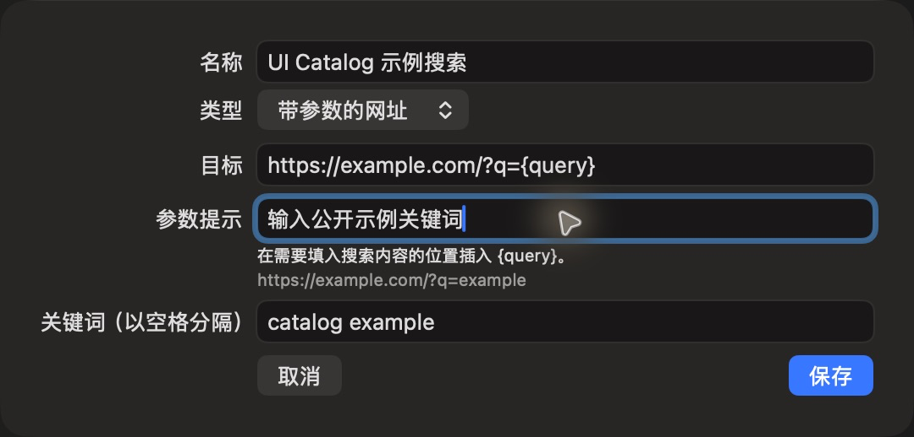

# 带参数的网址编辑

批次：G · 2026-10-31，正常 dev 构建。

进入路径：设置 → 快捷入口 → 添加快捷入口。

状态及操作：随后保存 UI Catalog 示例搜索，目标为 example.com，未打开网址。



## 版本和范围

源码 dev `2f41c6ae55fecb5a316ed765141276e671973a8d`，版本 1.0（1），运行包 `/private/tmp/zbox-ui-capture-build/Build/Products/Debug/zbox.app`。主搜索正常失焦关闭。深色外观，仅当前可见窗口；截图转换为真实 PNG，未缩放或重绘。功能启停和测试数据收尾见总索引。

## 源码定位

`zbox/Plugins/Quicklinks/QuicklinksSettingsView.swift:54`。文案资源为 `zbox/Localizable.xcstrings`。以下是局部 UI 摘录，省略其他依赖和回调，不能独立运行。

```swift
    var body: some View {
        Form {
            TextField("Name", text: $item.name)
            Picker("Type", selection: $item.kind) {
                Text("Parameterized URL").tag(Quicklink.Kind.template)
                Text("URL").tag(Quicklink.Kind.url)
                Text("File or Folder").tag(Quicklink.Kind.file)
            }
            TextField("Target", text: $item.target)
            if item.kind == .template {
                TextField("Parameter Prompt", text: Binding(get: { item.parameterPrompt ?? "" }, set: { item.parameterPrompt = $0 }))
                Text("Insert {query} where the search value belongs.").font(.caption)
                if let url = try? item.destination() {
                    Text(url.absoluteString).font(.caption).foregroundStyle(.secondary).textSelection(.enabled)
                }
            }
            if item.kind == .file {
                Button("Choose File or Folder") {
                    let panel = NSOpenPanel()
                    panel.canChooseDirectories = true
                    panel.canChooseFiles = true
```
