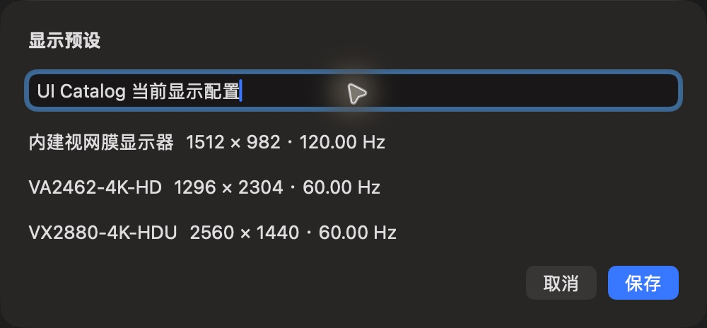

# 显示预设编辑

批次：G · 2026-10-31，正常 dev 构建。

进入路径：设置 → 显示器 → 保存当前显示预设。

状态及操作：保存 UI Catalog 当前显示配置，未应用预设或改变显示模式。



## 版本和范围

源码 dev `2f41c6ae55fecb5a316ed765141276e671973a8d`，版本 1.0（1），运行包 `/private/tmp/zbox-ui-capture-build/Build/Products/Debug/zbox.app`。主搜索正常失焦关闭。深色外观，仅当前可见窗口；截图转换为真实 PNG，未缩放或重绘。功能启停和测试数据收尾见总索引。

## 源码定位

`zbox/Plugins/Display/DisplaySettingsView.swift:150`。文案资源为 `zbox/Localizable.xcstrings`。以下是局部 UI 摘录，省略其他依赖和回调，不能独立运行。

```swift
    var body: some View {
        VStack(alignment: .leading, spacing: 16) {
            Text("Display Preset").font(.headline)
            TextField("Name", text: $preset.name)
            if let errorMessage { SettingsErrorView(message: errorMessage) }
            ForEach(preset.selections, id: \.displayID) { selection in
                LabeledContent(selection.displayName, value: "\(selection.mode.resolutionLabel) · \(selection.mode.refreshLabel)")
            }
            HStack {
                Spacer()
                Button("Cancel", role: .cancel) { dismiss() }
                Button("Save") {
                    preset.name = preset.name.trimmingCharacters(in: .whitespacesAndNewlines)
                    if save(preset) { dismiss() }
                }
                .keyboardShortcut(.defaultAction)
                .disabled(preset.name.trimmingCharacters(in: .whitespacesAndNewlines).isEmpty || preset.selections.isEmpty)
            }
        }
        .padding(20).frame(width: 500)
    }
```
