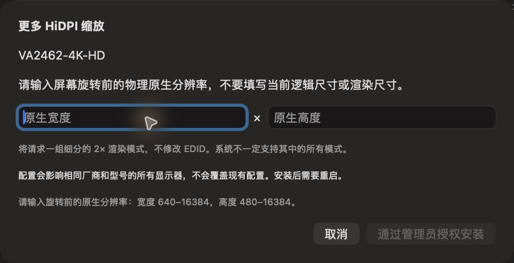

# HiDPI 配置表单

批次：G · 2026-10-31，正常 dev 构建。

进入路径：设置 → 显示器 → 配置更多 HiDPI 模式。

状态及操作：空白表单截图后取消，未安装或请求管理员授权。



## 版本和范围

源码 dev `2f41c6ae55fecb5a316ed765141276e671973a8d`，版本 1.0（1），运行包 `/private/tmp/zbox-ui-capture-build/Build/Products/Debug/zbox.app`。主搜索正常失焦关闭。深色外观，仅当前可见窗口；截图转换为真实 PNG，未缩放或重绘。功能启停和测试数据收尾见总索引。

## 源码定位

`zbox/Plugins/Display/DisplayHiDPIEditor.swift:3`。文案资源为 `zbox/Localizable.xcstrings`。以下是局部 UI 摘录，省略其他依赖和回调，不能独立运行。

```swift
struct DisplayHiDPIEditor: View {
    @Environment(\.dismiss) private var dismiss
    let display: DisplayInfo
    let manager: DisplayHiDPIManager
    @State private var width = ""
    @State private var height = ""

    private var configuration: DisplayHiDPIConfiguration? {
        guard let width = Int(width), let height = Int(height) else { return nil }
        return try? DisplayHiDPIConfiguration(vendor: display.vendor, product: display.product,
                                             nativeWidth: width, nativeHeight: height)
    }

    var body: some View {
        VStack(alignment: .leading, spacing: 16) {
            Text("Additional HiDPI").font(.headline)
            Text(display.name)
            Text("Enter the physical panel's native resolution before rotation, not the current looks-like or rendering size.")
            HStack {
                TextField("Native Width", text: $width)
                Text("×")
```
