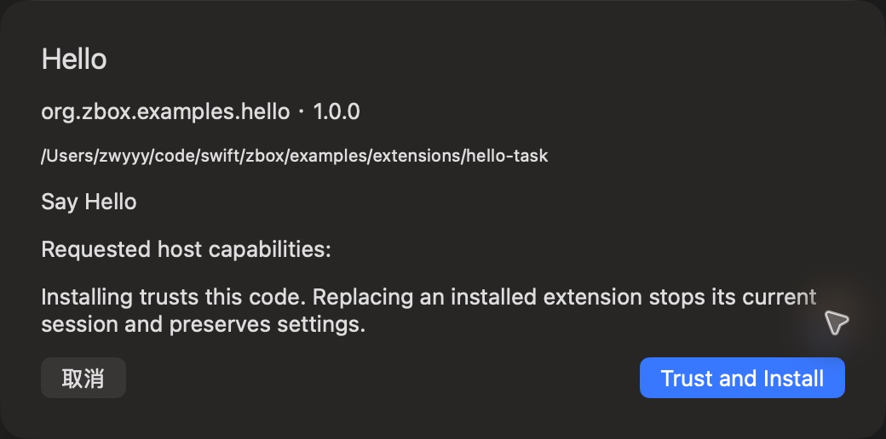

# 扩展安装确认

批次：G · 2026-10-31，正常 dev 构建。

进入路径：设置 → 扩展 → 导入仓库 hello-task。

状态及操作：截图后经用户明确确认安装 Hello 1.0.0；没有请求宿主能力。



## 版本和范围

源码 dev `2f41c6ae55fecb5a316ed765141276e671973a8d`，版本 1.0（1），运行包 `/private/tmp/zbox-ui-capture-build/Build/Products/Debug/zbox.app`。主搜索正常失焦关闭。深色外观，仅当前可见窗口；截图转换为真实 PNG，未缩放或重绘。功能启停和测试数据收尾见总索引。

## 源码定位

`zbox/ExternalExtensions/ExtensionSettingsView.swift:40`。文案资源为 `zbox/Localizable.xcstrings`。以下是局部 UI 摘录，省略其他依赖和回调，不能独立运行。

```swift
        .sheet(item: Binding(get: { manager.candidate }, set: { _ in })) { item in
            VStack(alignment: .leading, spacing: 12) {
                Text(item.manifest.name).font(.title2)
                Text("\(item.id) · \(item.manifest.version)")
                Text(item.source).font(.caption).textSelection(.enabled)
                Text(item.manifest.commands.map(\.name).joined(separator: ", "))
                Text("Requested host capabilities: \(item.grants.map(ExtensionManifest.capabilityLabel).joined(separator: ", "))")
                Text("Installing trusts this code. Replacing an installed extension stops its current session and preserves settings.")
                if let error = manager.error { SettingsErrorView(message: error) }
                HStack {
                    Button("Cancel") { Task { await manager.discardCandidate() } }
                    Spacer()
                    Button("Trust and Install") { Task { await manager.install() } }.keyboardShortcut(.defaultAction)
                }.disabled(manager.busy)
            }.padding(24).frame(width: 520).interactiveDismissDisabled()
        }
        .sheet(item: $editing) { item in ExtensionPreferencesView(item: item, manager: manager) }
        .sheet(item: $removing) { item in
            VStack(alignment: .leading, spacing: 16) {
                Text("Uninstall \(item.manifest.name)?").font(.headline)
                Text("This stops the current session and removes its commands and shortcuts.")
```
