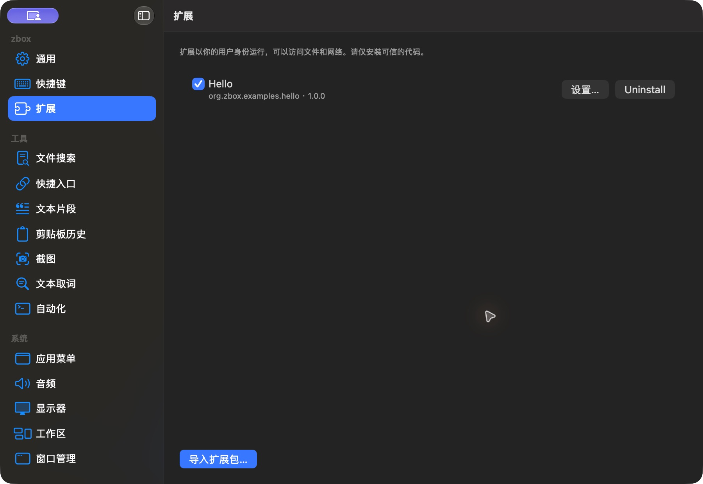

# 已安装扩展列表

批次：G · 2026-10-31，正常 dev 构建。

进入路径：设置 → 扩展。

状态及操作：Hello 1.0.0 已安装并启用。



## 版本和范围

源码 dev `2f41c6ae55fecb5a316ed765141276e671973a8d`，版本 1.0（1），运行包 `/private/tmp/zbox-ui-capture-build/Build/Products/Debug/zbox.app`。主搜索正常失焦关闭。深色外观，仅当前可见窗口；截图转换为真实 PNG，未缩放或重绘。功能启停和测试数据收尾见总索引。

## 源码定位

`zbox/ExternalExtensions/ExtensionSettingsView.swift:9`。文案资源为 `zbox/Localizable.xcstrings`。以下是局部 UI 摘录，省略其他依赖和回调，不能独立运行。

```swift
    var body: some View {
        VStack(alignment: .leading, spacing: 12) {
            Text("Extensions run as your user and can access files and the network. Install only code you trust.")
                .font(.caption).foregroundStyle(.secondary)
            List(manager.items) { item in
                HStack {
                    Toggle(isOn: Binding(get: { item.enabled }, set: { enabled in Task { await manager.setEnabled(item, enabled) } })) {
                        VStack(alignment: .leading) {
                            Text(item.manifest.name)
                            Text("\(item.id) · \(item.manifest.version)").font(.caption).foregroundStyle(.secondary)
                        }
                    }
                    Spacer()
                    Button("Settings…") { editing = item }
                    Button("Uninstall") { deleteData = false; removing = item }
                }
            }
            .overlay {
                if manager.items.isEmpty && !manager.busy && !manager.loadFailed {
                    ContentUnavailableView("No Extensions Installed", systemImage: "puzzlepiece.extension",
                                           description: Text("Import a trusted extension package to add commands to zbox."))
```
