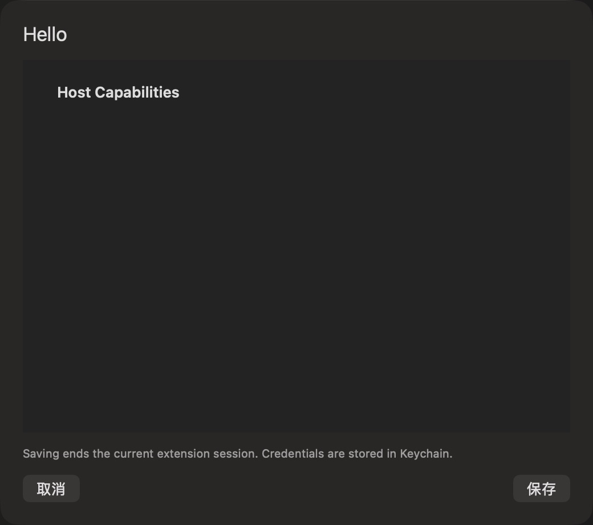

# 扩展偏好设置

批次：G · 2026-10-31，正常 dev 构建。

进入路径：设置 → 扩展 → Hello 设置。

状态及操作：Hello 没有偏好字段及宿主能力；截图后取消，未保存设置。



## 版本和范围

源码 dev `2f41c6ae55fecb5a316ed765141276e671973a8d`，版本 1.0（1），运行包 `/private/tmp/zbox-ui-capture-build/Build/Products/Debug/zbox.app`。主搜索正常失焦关闭。深色外观，仅当前可见窗口；截图转换为真实 PNG，未缩放或重绘。功能启停和测试数据收尾见总索引。

## 源码定位

`zbox/ExternalExtensions/ExtensionPreferencesView.swift:3`。文案资源为 `zbox/Localizable.xcstrings`。以下是局部 UI 摘录，省略其他依赖和回调，不能独立运行。

```swift
struct ExtensionPreferencesView: View {
    let item: ExtensionInstallation
    @Bindable var manager: ExtensionManager
    @Environment(\.dismiss) private var dismiss
    @State private var values: [String: String] = [:]
    @State private var grants: Set<String> = []
    @State private var loading = true
    @State private var error: String?

    var body: some View {
        VStack(alignment: .leading, spacing: 12) {
            Text(item.manifest.name).font(.title2)
            Form {
                Section("Host Capabilities") {
                    ForEach(item.manifest.capabilities ?? [], id: \.self) { capability in
                        Toggle(ExtensionManifest.capabilityLabel(capability), isOn: Binding(get: { grants.contains(capability) }, set: { enabled in
                            if enabled { grants.insert(capability) } else { grants.remove(capability) }
                        }))
                    }
                }
                ForEach(item.manifest.settings ?? []) { field in
```
