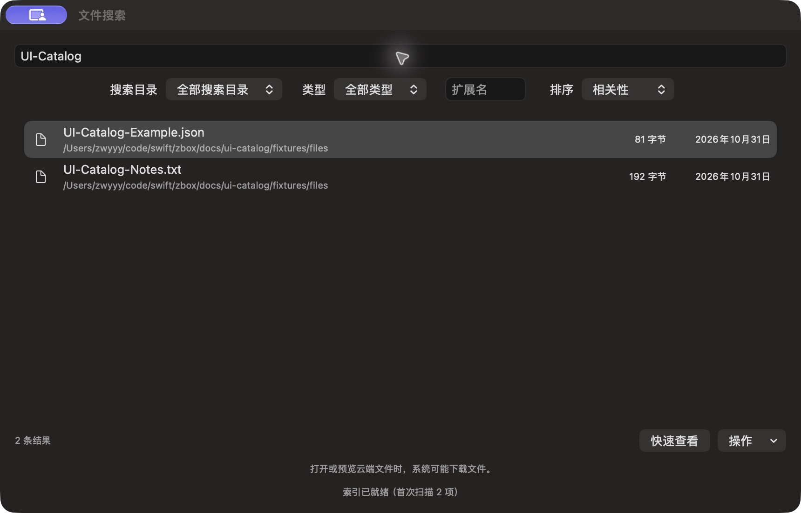

# 文件搜索结果列表

批次 G · 2026-10-31，正常 dev `2f41c6a` 构建，版本 1.0（1）。

进入路径：主搜索 → 文件搜索 → 查询公开测试文件。

状态：查询 UI-Catalog，显示限定测试目录中的 JSON 和 TXT 两条结果。



## 操作及可见范围

用户授权临时启用，索引仅含 `docs/ui-catalog/fixtures/files` 两份生成素材；未读取个人文件、复制或上传。深色外观，仅当前可见窗口，真实 PNG，未缩放或重绘。操作菜单未进入截图浮层，不计作已覆盖。功能恢复见索引。

## 源码

`zbox/Plugins/FileSearch/FileSearchView.swift:8`，文案位于 `zbox/Localizable.xcstrings`。局部 UI 摘录省略其余依赖，不可独立运行。

```swift
    var body: some View {
        VStack(spacing: 12) {
            TextField("Search file names — ext:pdf, type:folder, path:project", text: $plugin.query)
                .textFieldStyle(.roundedBorder).focused($focus, equals: .search)
            HStack {
                Picker("Search Folder", selection: $plugin.scope) {
                    Text("All Search Folders").tag("")
                    ForEach(plugin.settings.roots) { Text($0.url.lastPathComponent).tag($0.id.uuidString) }
                }
                Picker("Type", selection: $plugin.typeFilter) {
                    Text("All Types").tag("")
                    Text("Files").tag("file")
                    Text("Folders").tag("folder")
                }.frame(maxWidth: 160)
                TextField("Extension", text: $plugin.extensionFilter).frame(width: 85)
                Picker("Sort", selection: $plugin.sort) {
                    Text("Relevance").tag(FileSearchSort.relevance)
                    Text("Name").tag(FileSearchSort.name)
                    Text("Modified").tag(FileSearchSort.modified)
                }.frame(maxWidth: 170)
            }
            List(plugin.page.files, selection: $plugin.selectedID) { file in
                HStack(spacing: 12) {
```
