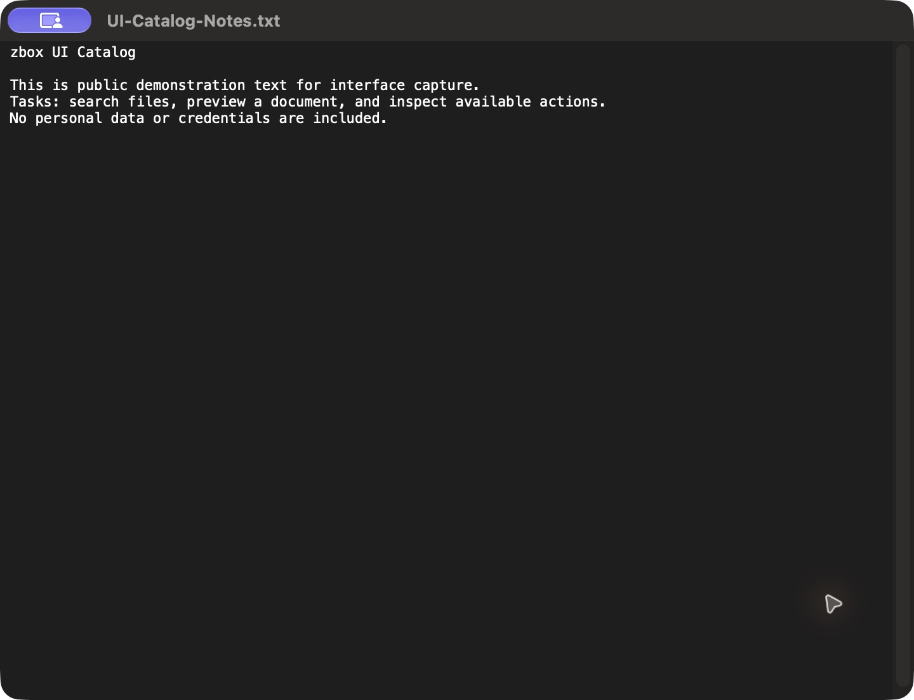

# 公开文本文件 Quick Look

批次 G · 2026-10-31，正常 dev `2f41c6a` 构建，版本 1.0（1）。

进入路径：主搜索 → 文件搜索 → 查询公开测试文件 → 快速查看。

状态：快速查看公开示例文本；截图后 Escape 关闭预览，并清空查询和扩展名过滤。



## 操作及可见范围

用户授权临时启用，索引仅含 `docs/ui-catalog/fixtures/files` 两份生成素材；未读取个人文件、复制或上传。深色外观，仅当前可见窗口，真实 PNG，未缩放或重绘。操作菜单未进入截图浮层，不计作已覆盖。功能恢复见索引。

## 源码

`zbox/Plugins/FileSearch/FileSearchActions.swift:15`，文案位于 `zbox/Localizable.xcstrings`。局部 UI 摘录省略其余依赖，不可独立运行。

```swift
        case .open:
            guard NSWorkspace.shared.open(url) else { throw FileSearchError.actionFailed }
        case .reveal:
            NSWorkspace.shared.activateFileViewerSelecting([url])
        case .copyFile, .copyPath:
            let board = NSPasteboard.general
            board.prepareForNewContents(with: .currentHostOnly)
            defer { coordinator.didWrite(changeCount: board.changeCount) }
            let success = action == .copyFile ? board.writeObjects([url as NSURL]) : board.setString(url.path, forType: .string)
            guard success else { throw FileSearchError.actionFailed }
        case .preview:
            closePreview()
            let panel = FileSearchPreviewPanel(contentRect: NSRect(x: 0, y: 0, width: 720, height: 520),
                styleMask: [.titled, .closable, .resizable, .nonactivatingPanel], backing: .buffered, defer: false)
            guard let view = QLPreviewView(frame: panel.contentView?.bounds ?? .zero, style: .normal) else {
                throw FileSearchError.actionFailed
            }
            panel.onDismiss = { [weak self] in self?.closePreview() }
            panel.title = url.lastPathComponent
            panel.contentView = view
            panel.isReleasedWhenClosed = false
            panel.collectionBehavior = [.canJoinAllSpaces, .fullScreenAuxiliary]
            panel.center()
```
